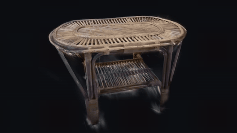
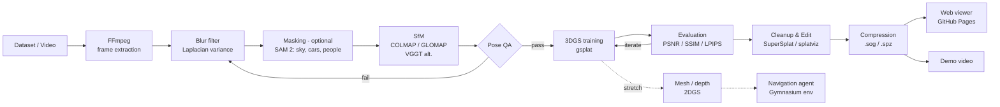
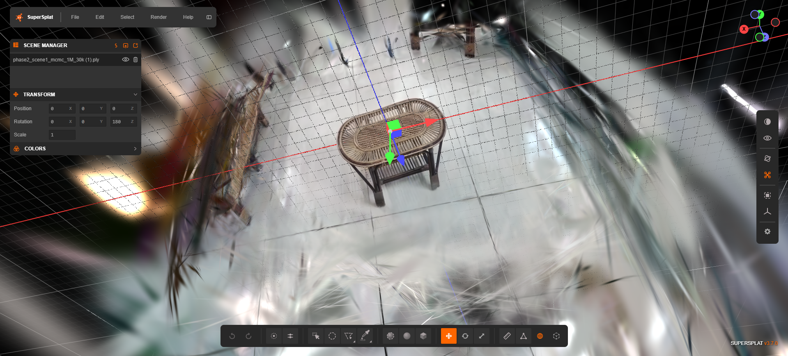
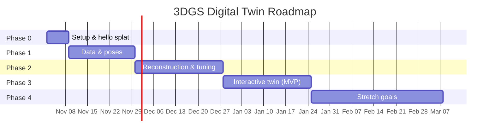

# Open-World Digital Twin with 3D Gaussian Splatting

> Multi-view video → camera poses → photoreal 3D Gaussian Splatting model → an interactive, editable digital twin you can explore in the browser (and, as a stretch goal, navigate with an AI agent).

### ▶ [Open the live 3D viewer](https://kishore-suthersingh.github.io/3dgs-digital-twin/viewer/): a wicker table reconstructed from a phone video. Drag to orbit, scroll to zoom.



*653,520 Gaussians, rendered with gsplat from the cleaned model · test PSNR 32.15 dB · [28 s demo video](docs/media/demo.mp4) (input video → raw vs cleaned → orbit)*

**Status:** ✅ Phase 0 complete · 🟡 Phase 1: garden poses validated, phone video working, Wayve stress test run (PSNR 15.2 on held-out front camera) · 🟡 Phase 2: garden done (mcmc 1M PSNR 26.99 vs paper 27.41; default `--packed` 27.22), bicycle mcmc 1M 25.22 (paper 25.25), table scene mcmc 1M 30k PSNR 32.15 (+2.39 dB over Phase 1b) · 🟡 Phase 3: cleanup script, web viewer and demo video done · **Started:** Nov 2026 · **Target MVP:** end of Phase 3 (~Week 11)

---

## Table of Contents
1. [What the Final Result Looks Like](#1-what-the-final-result-looks-like)
2. [Goals & Skills Demonstrated](#2-goals--skills-demonstrated)
3. [System Architecture](#3-system-architecture)
4. [Core Technical Decisions](#4-core-technical-decisions)
5. [Compute: Google Colab](#5-compute-google-colab)
6. [Repository Layout](#6-repository-layout)
7. [Environment Setup](#7-environment-setup)
8. [Phase-by-Phase Workflow](#8-phase-by-phase-workflow)
9. [Extra Ideas & Extensions](#9-extra-ideas--extensions)
10. [Evaluation Protocol](#10-evaluation-protocol)
11. [Timeline](#11-timeline)
12. [Documentation & Portfolio Checklist](#12-documentation--portfolio-checklist)
13. [Common Pitfalls → Fixes](#13-common-pitfalls--fixes)
14. [Legal & Data Notes](#14-legal--data-notes)
15. [Definition of "Done"](#15-definition-of-done)
16. [Progress Tracker](#16-progress-tracker)
17. [References](#17-references)

---

## 1. What the Final Result Looks Like

A **2–3 minute demo video** plus a **public web link** where anyone can:

1. See the original outdoor footage.
2. Watch the sparse point cloud and camera poses build up (Structure-from-Motion).
3. Watch the 3DGS model train from blurry blobs to a photoreal scene.
4. **Fly around the reconstructed scene in the browser** and play back recorded camera paths.
5. See editing in action: floaters removed, an object isolated or recolored, an object inserted.
6. *(Stretch)* Watch an agent navigate the twin using only rendered views as input.

The repo backs this up with **metrics tables, visual comparisons, a decision log, and a failure log**.

---

## 2. Goals & Skills Demonstrated

| Area | What this project shows |
|---|---|
| Spatial computing & camera geometry | SfM, intrinsics/extrinsics, bundle adjustment, pose quality analysis |
| Modern neural rendering | 3D Gaussian Splatting training, densification, SH appearance, evaluation |
| Systems engineering | Reproducible data pipeline, GPU-constrained training, compression, web delivery |
| Interactive 3D tools | Real-time viewer, camera paths, scene editing |
| (Stretch) Embodied AI | Navigation agent trained inside a reconstructed world |

This project is deliberately different from earlier Stable Diffusion / FastAPI / EEG work. It moves into **3D vision and neural rendering**.

---

## 3. System Architecture



**Data flow per stage**

| Stage | Input | Output |
|---|---|---|
| Frame extraction | `.mp4` / image folder | `images/*.jpg` |
| Filtering & masking | images | cleaned images (+ `masks/*.png`) |
| SfM | images | `sparse/0/{cameras,images,points3D}.bin` |
| Training | images + sparse model | `point_cloud.ply`, checkpoints, logs |
| Evaluation | checkpoint + test views | `metrics.json`, render grids |
| Editing / export | `.ply` | cleaned `.ply`, compressed `.sog` / `.spz` |
| Viewing | compressed splat | web page, videos |

---

## 4. Core Technical Decisions

| Decision | Choice | Reason |
|---|---|---|
| Primary representation | **3D Gaussian Splatting** | Real-time rendering, easy editing, good for interactive twins |
| Secondary (optional) | Zip-NeRF / Nerfacto | For comparison only |
| Data source | **Public outdoor datasets first** | Legal safety and faster learning. Own/game footage only later and kept private |
| Pose estimation | **COLMAP / GLOMAP** (VGGT as modern alternative) | Reliable, well understood baseline |
| Training library | **gsplat** | Modern, memory-efficient, well maintained, has the MCMC strategy |
| Editing priority | Basic first (floaters, color, simple inserts) | Text-guided editing is a stretch goal |
| Dynamics | Mask moving objects early | Full 4D is too hard for the MVP |
| Navigation agent | Stretch only | Only after the static twin is solid |
| Training compute | **Google Colab (T4 → L4/A100 if needed)** | Keeps local 6 GB laptop GPU free. See §5 |

Keep a running log of *why* each choice was made in `docs/decisions.md`.

---

## 5. Compute: Google Colab

**All GPU work runs on Google Colab.** The local laptop (RTX 3050 6 GB) is only used for editing code, SuperSplat (browser) and viewing results, so its VRAM isn't used for training.

| Concern | Approach |
|---|---|
| GPU | Colab **T4 (16 GB)** on the free tier. L4/A100 with Colab Pro for full-res or long runs |
| Sessions reset (files on `/content` are wiped) | Datasets + code live on fast local `/content/work` and are re-downloaded each session. **Results, exports and checkpoints go to Google Drive** (`MyDrive/3dgs-digital-twin/`) |
| Session time limits / disconnects | 7k-step experiments (minutes). 30k-step final runs save checkpoints to Drive |
| gsplat CUDA compile time | Build a compiled package once and keep it on Drive (`cache/wheels/`), then install it in later sessions. Falls back to compiling during training |
| Large datasets (Mip-NeRF 360 is ~12 GB) | `remotezip` pulls **only one scene** at the needed resolutions via HTTP range requests |
| Drive free space (15 GB) | Store only results, `.ply` exports and metrics on Drive. Never store raw datasets there |
| Memory on T4 | 1/4 resolution is comfortable. 1/2 res + MCMC cap for higher quality. Full-res on L4/A100 |

**Drive layout**
```
MyDrive/3dgs-digital-twin/
├── results/<run_name>/   # ckpts/, stats/, renders/ (written by gsplat trainer)
├── results/metrics.csv   # one row per run
├── exports/              # .ply / .sog / .spz for SuperSplat & web
├── env/                  # recorded package versions per phase
└── cache/wheels/         # compiled gsplat packages, per GPU + torch version
```

**Workflow:** notebooks live in `notebooks/` in this repo → open them in Colab (upload, or from GitHub once the repo is pushed) → run → results land on Drive → download `.ply` files to view them locally.

Keep logging training time, GPU type, #Gaussians and file size for every run.

---

## 6. Repository Layout

```
3D/
├── configs/            # per-scene and per-experiment YAML configs
│   ├── scenes/         # garden.yaml, bicycle.yaml, ...
│   └── experiments/    # mcmc_cap1m.yaml, sh0.yaml, ...
├── scripts/
│   ├── extract_frames.py
│   ├── filter_blur.py
│   ├── make_masks.py         # SAM 2 (optional)
│   ├── run_colmap.py         # COLMAP / GLOMAP wrapper
│   ├── pose_qa.py            # registration %, reprojection error, plots
│   ├── train.py              # thin wrapper around gsplat trainer
│   ├── evaluate.py           # PSNR / SSIM / LPIPS + render grids
│   ├── render_path.py        # camera path → video
│   └── export.py             # .ply → .sog / .spz
├── notebooks/          # exploration, plots for the write-up
├── viewer/             # web viewer (deployed via GitHub Pages)
├── agent/              # (stretch) Gymnasium env + policies
├── results/
│   ├── metrics.csv     # one row per run
│   ├── renders/
│   └── videos/
├── docs/
│   ├── architecture.png
│   ├── decisions.md    # why each choice was made
│   ├── failures.md     # what broke and how it was fixed
│   └── report.md       # final tech report / blog draft
├── data/               # gitignored: local datasets (in Colab: /content/work/data)
├── environment.yml
└── README.md
```

**Rule:** every stage is **one command + one config**, so any scene can be reproduced from a clean clone.

---

## 7. Environment Setup

### 7.1 Colab (training & processing)
Everything is installed by **`notebooks/00_setup_hello_splat.ipynb`**:
- GPU check, Google Drive mount, project folders
- `gsplat` (prebuilt wheel if available, else PyPI + JIT compile)
- gsplat repo cloned **at the same version tag** as the package (for `examples/simple_trainer.py`)
- trainer requirements (`pycolmap` fork, `fused-ssim`, `tyro`, `viser`, `torchmetrics`, …), `remotezip`, `plyfile`
- writes the exact versions to `Drive/3dgs-digital-twin/env/versions_phase0.txt`

COLMAP/GLOMAP for Phase 1 will also run in Colab (`apt` / prebuilt binaries); it gets added in the Phase 1 notebook.

### 7.2 Local (Windows, no GPU work)
- [SuperSplat](https://superspl.at/editor): view and edit `.ply` exports in the browser
- Git + VS Code (or any editor) for notebooks/scripts
- *(optional)* FFmpeg for preparing your own videos before uploading

### 7.3 Pinned versions
Recorded 2026-11-03 from a working Phase 0 run (full list: [`docs/env/versions_phase0.txt`](docs/env/versions_phase0.txt)):

| Component | Version |
|---|---|
| Colab GPU / driver | Tesla T4 (16 GB) / 580.82.07 |
| Python | 3.13.16 |
| PyTorch / CUDA | 2.11.0+cu130 / CUDA 13.0 (Phase 0); Colab moved to **2.14.1+cu130** by Phase 2 |
| gsplat | 1.5.3 (repo cloned at tag `v1.5.3`) |
| numpy | 2.4.6 (gsplat's `numpy<2` pin removed) |
| fused-ssim | git `328dc98` (built with `--no-build-isolation`) |
| fused-bilagrid | git `90f9788` (built with `--no-build-isolation`) |
| pycolmap (rmbrualla fork) | git `cc7ea4b` (patched for numpy 2, see `docs/failures.md` F0.5) |
| nerfview / viser / tyro | git `4538024` / 1.1.1 / 1.0.16 |
| COLMAP (Phase 1, separate conda env) | 4.2.1 CUDA build + GPU `libfaiss` 1.14.3 (conda-forge) |

Version mismatches are the #1 time sink. When Colab updates its base image, compare against this table first.

---

## 8. Phase-by-Phase Workflow

Each phase has a **goal, steps, deliverables, and exit criteria**. Don't move on until the exit criteria pass.

### Phase 0: Setup & "Hello Splat" (Week 0)

**Goal:** prove the whole toolchain works end to end before investing in quality.

**Notebook:** [`notebooks/00_setup_hello_splat.ipynb`](notebooks/00_setup_hello_splat.ipynb) (Colab, T4 GPU → `Runtime → Run all`)

Steps:
1. GPU check + mount Google Drive.
2. Install gsplat + trainer dependencies and record versions.
3. Smoke test: rasterize random Gaussians (also compiles CUDA kernels).
4. Download **only** the Mip-NeRF 360 **garden** scene (`sparse/`, `images_8/`, `images_4/`) with `remotezip`.
5. Train 7k steps at 1/8 resolution (`images → images_8` symlink + `simple_trainer.py default --data_factor 1 --max_steps 7000`).
6. Read PSNR / SSIM / LPIPS and view GT-vs-render images.
7. Export a standard 3DGS `.ply` → open it in SuperSplat.
8. Append the run to `results/metrics.csv` on Drive.

Exit criteria:
- [x] Training runs without crashing on Colab. *(garden, 7k steps. Ran at ~81×52 px by mistake, see `docs/failures.md` F1.2, so its PSNR of 30.51 isn't a real 1/8 result)*
- [x] A `.ply` opens in SuperSplat and is recognisably the scene (even if ugly). *(table, lawn, borders, back wall all visible; floaters outside the capture circle)*
- [x] Versions recorded in §7.3.

---

### Phase 1: Data Acquisition & Poses (Weeks 1–3)

**Goal:** reliable multi-view images plus accurate camera poses.

**Notebooks:**
- [`notebooks/01_colmap_poses_garden.ipynb`](notebooks/01_colmap_poses_garden.ipynb): COLMAP 4.2.1 (CUDA, via micromamba) + optional global SfM on garden → pose QA vs the official poses (Umeyama alignment, rotation/center error) → train on official vs our poses at 1/4 resolution, 7k steps, VGG LPIPS.
- [`notebooks/01b_phone_video.ipynb`](notebooks/01b_phone_video.ipynb): your own phone video: FFmpeg → sharpest frame per time window → sequential matching + loop detection → pose QA without a reference → gsplat. Filming guide: [`docs/capture_guide.md`](docs/capture_guide.md).
- [`notebooks/01c_wayve_driving.ipynb`](notebooks/01c_wayve_driving.ipynb): WayveScenes101 `scene_078` (5 fisheye cameras, 1,000 images). Fisheye → pinhole undistortion with OpenCV, Wayve's masks, and Wayve's protocol: train on the 4 side cameras, test on the held-out front camera. Uses the supplied poses (checked by reprojection), so no COLMAP. **Non-commercial licence: see §14.**
- *(later)* SAM 2 masks for moving objects, in a scene that has traffic.

**Garden pose QA result** (COLMAP 4.2.1, 1/4-res images, compared with the official poses):

| Check | Result | Target |
|---|---|---|
| Registered images | 185 / 185 (100%) | > 95% |
| Mean reprojection error | 0.457 px | < ~1 px |
| 3D points / mean track length | 128,182 / 7.66 | – |
| Rotation error, median (max) | 0.012° (0.03°) | median < 0.5° |
| Camera-center error, median (max) | 0.02% (0.06%) of scene radius | median < 2% |

The official poses also come from COLMAP, so this shows close agreement with a trusted reference, not error against true ground truth.

**Effect on training** (same undistorted images, same camera, 7k steps): official poses PSNR 27.73, our poses PSNR 27.75, a difference of +0.03 dB before rounding. **Our poses are equivalent for training.**

**Phone video result** (wicker table, 118 s video at 848×478, COLMAP 4.2.1, sequential matching with loop detection):

| Check | Result |
|---|---|
| Registered frames | 300 / 300 (100%) |
| Mean reprojection error | 0.531 px |
| 3D points / mean track length | 50,204 / 7.41 |
| Matching / mapping time | 6.1 min / 4.7 min |
| Jumps in the camera path / unregistered gaps | 0 / 0 |
| After 7k steps | 541,980 Gaussians at 834×468, PSNR 29.76, SSIM 0.951, LPIPS 0.166 (VGG) |

⚠️ These scores can't be compared with garden's: held-out video frames sit right next to training frames, which makes them easier to predict. There's no reference here either, so these checks only rule out visible failures. The table reconstructs well; the floor reflections and rarely seen background don't. See [`docs/images/phase1b_supersplat_view1.png`](docs/images/phase1b_supersplat_view1.png) and [`docs/images/phase1b_pose_qa.png`](docs/images/phase1b_pose_qa.png).

**Wayve stress test** (`scene_078`, 5 fisheye cameras undistorted to 960×540 pinhole, train on 800 side-camera images, test on 100 held-out front-camera images, 15k steps, T4):

| Check | Result |
|---|---|
| Reprojection, fisheye on originals (median) | 0.66 px (0.54-0.72 per camera) |
| Reprojection, after our undistortion (median) | 0.34 px (0.27-0.40 per camera) |
| Loader split | train 800 / test 100, front camera never in training, 97.4% of pixels kept by the mask |
| Training | 36.8 min in total, ~15 min of which was gsplat compiling (F1.5). Speed fell from 21 to 11 steps/s as the Gaussian count grew |
| Held-out front camera | PSNR 15.21, SSIM 0.547, LPIPS 0.486 (VGG), 1,891,439 Gaussians |
| Training loop / peak VRAM / render | 33.2 min (gsplat's own timer) / 2.85 GB / ~49 FPS |

The pipeline works end to end on fisheye, multi-camera, masked data: poses and undistortion check out to well under a pixel, and the split is correct. Seen from the road, the street is recognisable (buildings, parked car, signs), but there are needle-shaped floaters, and from outside the driven path the scene breaks into sky splats, as expected for a capture that only drives in a line. The low front-camera score is not yet explained: it could be the off-axis view, colour differences between cameras, or the sky. Not diagnosed yet. Wayve is a stress test for the pipeline only; the portfolio twin uses our own captures (licence: §14).

**Dataset order (easy → hard):**

| # | Scene | Why |
|---|---|---|
| 1 | Mip-NeRF 360 **garden** | Clean, has reference poses → validate your own COLMAP run |
| 2 | Mip-NeRF 360 **bicycle / stump / treehill / flowers** | More variety, still clean |
| 3 | **Your own phone video** | Real capture with no reference poses, and full control over filming |
| 3b | *(optional)* One **DL3DV-10K** outdoor scene | Real-world capture, raw video |
| 4 | One **WayveScenes101** scene | Driving / open-road feel, moving objects, exposure changes |

**Steps**

1. **Extract frames** (for video sources):
   ```bash
   ffmpeg -i input.mp4 -vf fps=3 -qscale:v 2 data/<scene>/images/%05d.jpg
   ```
   2–5 fps is usually enough. Too many near-duplicate frames slow COLMAP without improving quality.

2. **Filter blurry frames:** compute the variance of the Laplacian (OpenCV) and drop the bottom ~10–15%.

3. **Run Structure-from-Motion:**
   ```bash
   colmap feature_extractor --database_path db.db --image_path images \
       --ImageReader.single_camera 1 --ImageReader.camera_model OPENCV
   colmap sequential_matcher --database_path db.db     # video; use exhaustive_matcher for unordered photos
   colmap mapper --database_path db.db --image_path images --output_path sparse
   # or, faster global SfM:
   glomap mapper --database_path db.db --image_path images --output_path sparse
   ```
   Then create downscaled copies (`images_2`, `images_4`, `images_8`) for training.

4. **Validate against ground truth:** re-run COLMAP yourself on garden and compare with the official poses (align and measure rotation/translation error). This is your first real validation result.

5. **(Optional) Masks:** use SAM 2 to mask sky, cars, people or HUD elements. Needed mainly for scenes 3–4.

**Pose QA checklist** (`scripts/pose_qa.py`):
- [ ] > 95% of images registered
- [ ] Mean reprojection error < ~1 px
- [ ] Sparse point cloud looks right when you inspect it (no doubled walls, no broken-off chunks)
- [ ] Camera trajectory is smooth (for video)

**Deliverables:** frame extraction, blur filter and COLMAP scripts; pose QA report with screenshots; `docs/failures.md` entries.

---

### Phase 2: High-Quality Static Reconstruction (Weeks 4–7)

**Goal:** photorealistic, navigable 3DGS model.

**Notebook:** [`notebooks/02_quality_garden.ipynb`](notebooks/02_quality_garden.ipynb). It runs garden at 1/4 resolution (`images_4`, official poses, `--data_factor 1`) for the full 30k steps, scoring at 7k and 30k, with VGG LPIPS. Experiments: `mcmc_1M`, `default`, `mcmc_500k`, **one per Colab session** (gsplat 1.5.3 can't resume a run). It reports peak VRAM, train time, render FPS and `.ply` size, plus render grids (real | render | error), and compares with the published 3DGS garden numbers.

**Second scene:** [`notebooks/02b_quality_table.ipynb`](notebooks/02b_quality_table.ipynb) applies the garden winner (MCMC 1M, 30k) to our own wicker-table video. It uses the same frames, poses and test split as Phase 1b, so the two runs compare fairly. It also saves the training-ready scene to Drive (`datasets/scene1_ready.zip`) so Phase 3 can skip COLMAP.

**Gap-filling runs (Kaggle):** [`notebooks/02c_kaggle_fill_gaps.ipynb`](notebooks/02c_kaggle_fill_gaps.ipynb) trains bicycle (mcmc 1M, 30k) and retries garden default at 30k with `expandable_segments` and `--packed` (F2.1). It runs as a committed Kaggle notebook, so it keeps going with the browser closed. The first attempt trained on both Kaggle GPUs by accident and was discarded (F2.2). **On one T4:** bicycle mcmc 1M reached **25.22 dB** (paper 25.25), and garden default `--packed` finished at **27.22 dB** (paper 27.41) with 7.8M Gaussians and 11.3 GB peak, so the Colab out-of-memory crash (F2.1) was fragmentation plus the unpacked mode, not a hard 16 GB limit.

| Table scene (834×468, every 8th frame held out) | Gaussians | PSNR / SSIM / LPIPS | Train | VRAM | Size |
|---|---|---|---|---|---|
| Phase 1b: default, 7k | 541,980 | 29.76 / 0.951 / 0.166 | — | — | — |
| mcmc 1M, 7k | 1,000,000 | 29.32 / 0.949 / 0.148 | 5.1 min | 1.4 GB | 248 MB |
| **mcmc 1M, 30k** | 1,000,000 | **32.15 / 0.965 / 0.106** | 45.1 min | 1.8 GB | 248 MB |

- **+2.39 dB PSNR, LPIPS 0.166 → 0.106** over Phase 1b. At 7k steps MCMC is slightly below default, as on garden; the gain comes from the longer run.
- **In SuperSplat** (below): the table is sharp. The floor, bench and walls are smeared, with streak-shaped Gaussians, because the video was filmed around the table and saw the rest only at the edges. The scores don't show this: the test frames come from the same orbit. **Phase 3:** crop to the table and floor in SuperSplat; a wider capture would fix the surroundings.
- These scores can't be compared with garden's: held-out video frames sit right next to training frames.



**Steps** (general plan; the notebook covers steps 1-5 for garden)

1. **Baseline run** on garden at 1/4 resolution:
   ```bash
   cd gsplat/examples
   python simple_trainer.py default --data_dir ../../data/360_v2/garden \
       --data_factor 4 --result_dir ../../results/garden_default
   ```
2. **Memory-capped run** (MCMC strategy):
   ```bash
   python simple_trainer.py mcmc --data_dir ../../data/360_v2/garden \
       --data_factor 4 --result_dir ../../results/garden_mcmc
   # cap the Gaussian count via the strategy options (check: python simple_trainer.py mcmc --help)
   ```
3. **Experiment matrix:** change one factor at a time and log everything to `results/metrics.csv`:

   | Factor | Values to try |
   |---|---|
   | Strategy | default (ADC) vs MCMC |
   | Gaussian cap | 300k / 500k / 1M |
   | SH degree | 0 vs 3 |
   | Resolution | 1/8 vs 1/4 (vs 1/2 on cloud) |
   | Densification threshold | default vs ±50% |
   | Appearance handling | off vs appearance embeddings / bilateral grid |
   | Steps | 7k vs 30k |

4. **Evaluate:** PSNR / SSIM / LPIPS on held-out views, plus a visual check for floaters, holes, blur, and needle-shaped Gaussians.
5. **Target:** within ~1 dB PSNR of the published 3DGS results for the same scene and resolution.
6. **Move to harder scenes** (DL3DV, Wayve). Expect sky floaters, ghosting from moving cars and exposure flicker. Fix them with masks and appearance modelling, and document each fix.

**Deliverables:** metrics table; side-by-side renders (ground truth | render | error map); training progress GIF; failure log.

Exit criteria:
- [ ] Novel views look close to the real images on at least 2 scenes
- [ ] Metrics table filled in
- [ ] Model loads in a viewer

---

### Phase 3: Interactive Digital Twin (MVP) (Weeks 8–11)

**Goal:** free exploration plus basic editing, available to anyone.

**Steps**

1. **Cleanup in SuperSplat:** select and delete floaters, crop to the scene bounds, remove low-opacity junk.
2. **Basic edits:**
   - isolate an object (e.g. a table or tree) and export it separately
   - change the color or opacity of a selection
   - insert a simple object (another splat or a primitive) into the scene
3. **Code-based editing (splatviz / Python):** write small scripts that filter Gaussians by opacity, scale or bounding box. This shows you understand the representation, not just the GUI.
4. **Camera paths:** record keyframes, interpolate them smoothly, render to video (`scripts/render_path.py`).
5. **Compression & web delivery:** export to `.sog` / `.spz` and host on **GitHub Pages** with a web viewer (SuperSplat/PlayCanvas viewer or a Three.js-based splat viewer). Test on an ordinary laptop.
6. **Demo video (most important for interviews):**
   footage → COLMAP point cloud → training timelapse → free flight → editing → metrics overlay.

**Progress so far (table scene):**
- **`scripts/clean_splat.py`** (CPU, numpy only):
  - fits the floor plane with RANSAC and builds a level frame (floor at height 0, origin under the table);
  - keeps a cylinder around the table: radius 0.75, up to 0.75 above the floor;
  - drops Gaussians with opacity below 0.002, longest axis above 0.08, and large needles above the floor (longest axis over 0.04 and more than 8× the second-longest).
  - **1,000,000 → 722,084 Gaussians.** It writes a cleaned `.ply` (original coordinates, full SH, for SuperSplat) and levelled, y-up `.splat` files (base colour only) for the web, split into:
    - **object** (653,520 Gaussians, 20.9 MB): everything inside the table's footprint ellipse, except the floor under it;
    - **scanned floor** (68,564, 2.2 MB): everything outside the footprint, plus the ground under the table: flat, horizontal Gaussians, and below 9 cm everything that isn't on a leg (legs = grid cells near the footprint rim holding solid Gaussians just above the floor). The second rule came from the demo video: ~11,000 faint, streaky floor Gaussians under the shelf rendered as a grey smear between the legs. Dropping the higher SH costs little here: the tabletop's brightness is the same with or without them.
  - **Lesson from the first try:** filters at opacity 0.005 and needles over 0.01, plus the viewer hiding everything below 2% opacity, made the tabletop look patchy white and removed the floor. MCMC builds the wicker and the floor from many faint, thin Gaussians: 47% of the tabletop's Gaussians are below 2% opacity, and the "needles" removed were 99% wicker strands. Measure what a filter removes, and where, before trusting it.
  ```bash
  python scripts/clean_splat.py "phase2_scene1_mcmc_1M_30k (1).ply" --out exports/table_clean
  ```
- **`viewer/index.html`:** a three.js page using `@mkkellogg/gaussian-splats-3d` 0.4.7. It loads `table.splat` and `floor.splat` and has a floor switch: **Clean** (a plain disc in the scanned tile colour with a soft shadow, labelled as not scanned), **Scanned** and **None**. It needs no special server headers, so it works on GitHub Pages. Local test: `cd viewer && python -m http.server 8000`.
- **[`notebooks/03_demo_video.ipynb`](notebooks/03_demo_video.ipynb)** (Colab, T4): runs the same cleanup on the Drive copy of the model, then renders with gsplat at full SH: the input video, raw vs cleaned side by side, and a 12 s orbit. It joins them into `demo.mp4` and makes `orbit.gif` for this README. The camera orbits the table centre with "up" set to the fitted floor normal, so the table stays level. **Done:** [`docs/media/demo.mp4`](docs/media/demo.mp4) (28 s, 1280×720) and the GIF at the top. The first run showed a grey smear under the table, which led to the under-object floor rule above. Small white tufts at the feet remain (floor Gaussians in the same grid cells as the legs).

Exit criteria (**MVP**):
- [ ] A stranger can open the link and fly around smoothly
- [x] Obvious artifacts are cleaned (small tufts at the feet remain)
- [x] Demo video published (28 s cut; the narrated 2-3 min version is still open)
- [x] README updated with GIFs, metrics and the link

---

### Phase 4: Stretch Goals (Week 12+)

Only start after the MVP passes. Ordered by portfolio value relative to effort:

1. **Pose estimation comparison:** VGGT (feed-forward) vs COLMAP/GLOMAP on the same scenes. Compare speed, pose error and final PSNR.
2. **Geometry for the twin:** extract depth and mesh using **2DGS** (or PGSR). This gives collision geometry for navigation and measurements.
3. **Semantic twin:** lift SAM/CLIP features into the Gaussians (Feature-3DGS / LangSplat style) so you can click an object, or type "bench", to select it.
4. **Navigation agent:**
   - Wrap the gsplat renderer as a **Gymnasium** environment (observation = rendered RGB(-D), action = move/turn).
   - Use the 2DGS mesh for collisions.
   - Start with **imitation learning from recorded camera paths**, then try RL (PPO) for goal reaching.
5. **Better dynamics:** robust masking of moving objects in driving scenes, and comparison with a 4DGS method.
6. **NeRF comparison:** Zip-NeRF / Nerfacto through nerfstudio. Compare quality, training time, render FPS and size.
7. **Compression study:** plot file size vs PSNR (quantisation, SH pruning, Gaussian count).
8. **Scale up:** connect multiple regions, mild lighting or weather variations.

---

## 9. Extra Ideas & Extensions

Additions beyond the original plan:

- **Phase 0 smoke test:** catches setup problems before they eat Week 1.
- **Ground-truth pose validation** on garden before trusting your own captures.
- **Colab-first compute** with Drive persistence and single-scene downloads (§5).
- **A web-hosted twin**, not just local viewers. Reviewers click links; they don't install tools.
- **Geometry and semantics:** turn a pretty splat into a real digital twin an agent can use.
- **Reproducibility:** configs, fixed seeds, TensorBoard / W&B logging, one command per stage.
- **Failure-first documentation:** a good `failures.md` impresses more than perfect results.
- **Write-up:** a blog post or short tech report (`docs/report.md`) at the end roughly doubles the portfolio value.
- **Your own capture (later, private):** walk around a campus spot with a phone (slow, steady, overlapping) and reconstruct it. This shows you can handle real capture, not just curated datasets.

---

## 10. Evaluation Protocol

- **Train/test split:** hold out every 8th image (the standard Mip-NeRF 360 protocol).
- **Metrics:** PSNR ↑, SSIM ↑, LPIPS ↓ on held-out views. ⚠️ gsplat's trainer defaults to **AlexNet** LPIPS, which gives lower numbers. Use `--lpips_net vgg` for runs compared against published 3DGS results.
- **System metrics:** #Gaussians, training time, peak VRAM, render FPS, file size (raw `.ply` and compressed).
- **Qualitative:** fixed set of render grids (GT | render | error) for every final model.

**Results** (`results/metrics.csv` → rendered here). ⚠️ Only compare rows scored against the same images: original-JPG and undistorted rows aren't comparable (`docs/failures.md` F1.3). For comparison with published results, use the provided `images_4` with the official poses and `--data_factor 1`, as the published 3DGS results do (`02` notebook). Published 3DGS garden at 30k: PSNR 27.41, SSIM 0.868, LPIPS 0.103 (Kerbl et al. 2023, per-scene table; check before quoting).

| Scene | Res | Strategy | #Gaussians | Steps | PSNR | SSIM | LPIPS | Train time | Peak VRAM | Size (.ply / web .splat) |
|---|---|---|---|---|---|---|---|---|---|---|
| garden *(Phase 0, invalid: bug F1.2)* | ~1/64 | default | 483,133 | 7k | 30.51 | 0.948 | 0.019 (alex) | 5.0 min | 0.73 GB | 120 MB / 15 MB |
| garden, official poses, original JPGs | 1/4 | default | 3,624,313 | 7k | 25.98 | 0.809 | 0.203 | 12.4 min | 5.40 GB | 899 MB / 116 MB |
| garden, official poses, undistorted images | 1/4 | default | 2,421,936 | 7k | 27.73 | 0.854 | 0.175 | 9.8 min | 3.65 GB | 601 MB / 78 MB |
| garden, **our COLMAP poses**, undistorted images | 1/4 | default | 2,424,820 | 7k | **27.75** | 0.855 | 0.176 | 9.9 min | 3.64 GB | 601 MB / 78 MB |
| garden *(Phase 2, 7k checkpoint)* | 1/4 | mcmc 1M | 1,000,000 | 7k | 25.93 | 0.812 | 0.189 | 6.4 min | 1.3 GB | 248 MB / 32 MB |
| garden *(Phase 2)* | 1/4 | mcmc 1M | 1,000,000 | 30k | **26.99** | 0.849 | 0.139 | 35.1 min (T4) | 3.4 GB | 248 MB / 32 MB |
| garden *(Phase 2, 7k checkpoint)* | 1/4 | default | 5,377,074 | 7k | 26.34 | 0.833 | 0.154 | 16.4 min | 7.96 GB | 1,334 MB / 172 MB |
| garden *(Phase 2, Colab)* | 1/4 | default | – | 30k | *out of memory on T4 at ~11.8k steps (F2.1, fixed below)* | – | – | – | 14.6 GB T4 full | – |
| garden *(Phase 2, 7k checkpoint)* | 1/4 | mcmc 500k | 500,000 | 7k | 25.55 | 0.791 | 0.223 | 5.2 min | 0.8 GB | 124 MB / 16 MB |
| garden *(Phase 2)* | 1/4 | mcmc 500k | 500,000 | 30k | 26.43 | 0.825 | 0.180 | 25.7 min (T4) | 3.0 GB | 124 MB / 16 MB |
| garden *(Kaggle `02c`, 7k checkpoint)* | 1/4 | default `--packed` | 5,359,360 | 7k | 26.32 | 0.833 | 0.154 | 16.8 min (T4) | 7.8 GB | 1,329 MB / 171 MB |
| garden *(Kaggle `02c`)* | 1/4 | default `--packed` | 7,786,777 | 30k | **27.22** | **0.865** | **0.104** | 157.7 min (T4) | 11.3 GB | 1,931 MB / 249 MB |
| bicycle *(Kaggle `02c`, 7k checkpoint)* | 1/4 | mcmc 1M | 1,000,000 | 7k | 22.92 | 0.633 | 0.357 | 4.3 min (T4) | 1.3 GB | 248 MB / 32 MB |
| bicycle *(Kaggle `02c`)* | 1/4 | mcmc 1M | 1,000,000 | 30k | **25.22** | 0.763 | 0.225 | 33.4 min (T4) | 3.2 GB | 248 MB / 32 MB |
| table (phone video, own split) | 834×468 | mcmc 1M | 1,000,000 | 30k | 32.15 | 0.965 | 0.106 | 45.1 min (T4) | 1.80 GB | 248 MB / 23 MB (cleaned, 722k) |

**Phase 2 garden summary (T4, 30k steps, published 3DGS: 27.41 / 0.868 / 0.103):**

| Strategy | Gaussians | PSNR | vs paper | LPIPS | Train | Peak VRAM | Render (eval pass) | `.ply` |
|---|---|---|---|---|---|---|---|---|
| mcmc 1M | 1.0M | **26.99** | −0.42 dB ✅ | 0.139 | 35 min | 3.4 GB | ~67 FPS | 248 MB |
| mcmc 500k | 0.5M | 26.43 | −0.98 dB ✅ (just) | 0.180 | 26 min | 3.0 GB | ~107 FPS | 124 MB |
| default (ADC) `--packed` | 7.8M | **27.22** | −0.19 dB ✅ | **0.104** | 158 min | 11.3 GB | ~13 FPS | 1.9 GB |

Default ADC (run on Kaggle once `--packed` + `expandable_segments` made it fit, F2.1) is the closest to the paper: +0.23 dB and much better LPIPS (0.104 vs 0.139) than mcmc 1M, but with 7.8× the Gaussians, 4.5× the training time, 3.3× the VRAM, ~5× slower rendering and a 1.9 GB file. For a web twin that trade isn't worth it.

**bicycle (Kaggle, mcmc 1M, 30k): 25.22 / 0.763 / 0.225**, −0.03 dB from the paper (25.25) in 33 min and 3.2 GB peak. So the recipe holds on a second scene.

Halving the Gaussians (1M → 500k) costs 0.56 dB PSNR and a clearly worse LPIPS (0.139 → 0.180), but makes the file half the size and renders ~60% faster. **mcmc 1M is our default recipe**; 500k is the option for the web viewer if file size matters.

Sizes: `.ply` = 62 floats (248 bytes) per Gaussian; web `.splat` = 32 bytes per Gaussian (position, scale, colour, rotation; no view-dependent colour). Train time and peak VRAM come from gsplat's own stats files (training loop only, without evaluation or compiling), collected by [`notebooks/99_collect_metrics.ipynb`](notebooks/99_collect_metrics.ipynb) from the run folders on Drive (CPU only). That's why the "our COLMAP poses" row now says 9.9 min instead of the earlier wall-clock 12 min.

---

## 11. Timeline

Part-time, roughly 10–12 h/week.

| Week | Phase | Focus | Milestone |
|---|---|---|---|
| 0 | 0 | Colab environment, hello splat | Toolchain works |
| 1 | 1 | Mip-NeRF 360 download, COLMAP on garden | First sparse model |
| 2 | 1 | Pose QA script, GT pose comparison | Pose QA report |
| 3 | 1 | DL3DV / Wayve frames, blur filter, masks | 4 scenes with poses |
| 4 | 2 | Baseline gsplat training | First real splat |
| 5 | 2 | Experiment matrix (strategy, cap, SH) | metrics.csv populated |
| 6 | 2 | Evaluation scripts, render grids | Comparison figures |
| 7 | 2 | Hard scenes, appearance handling | Final static models |
| 8 | 3 | SuperSplat cleanup & editing | Clean `.ply` |
| 9 | 3 | Code-based editing, camera paths | Path videos |
| 10 | 3 | Compression + web viewer | Public link |
| 11 | 3 | Demo video + README polish | **MVP** |
| 12+ | 4 | Stretch goals | Extended results + write-up |



---

## 12. Documentation & Portfolio Checklist

- [ ] Architecture diagram (`docs/architecture.png` + Mermaid above)
- [ ] Capture and processing decisions (`docs/decisions.md`)
- [ ] Quantitative metrics table
- [ ] Visual comparisons (GT vs render, before/after cleanup)
- [ ] Failure cases and fixes (`docs/failures.md`)
- [ ] Training timelapse GIF
- [ ] **Demo video** (2–3 min)
- [ ] Public web viewer link
- [ ] Tech report / blog post
- [x] A clean README hero section (GIF + one-line pitch + link)

---

## 13. Common Pitfalls → Fixes

| Pitfall | Fix |
|---|---|
| Starting with chaotic game footage or commercial game assets publicly | Public datasets first. Game footage stays private |
| Trying full 4D dynamics or text-guided editing too early | Mask dynamics. Advanced editing is Phase 4 |
| Ignoring pose quality (bad poses = bad reconstruction) | Pose QA checklist before every training run |
| Scenes too large for the GPU | 1/4 resolution, MCMC cap, L4/A100 runtime for full-res |
| Skipping visual checks of intermediate results | Screenshot every stage, and stop at the first bad stage |
| CUDA / PyTorch / gsplat version mismatch | Pin versions in Phase 0 and record them |
| `fused-ssim` fails with "Failed to build ... when getting requirements to build wheel" | Its `setup.py` imports torch → `pip install --no-build-isolation <fused-ssim url>` |
| COLMAP fails on sky or textureless regions | Mask the sky, sequential matching for video, try GLOMAP |
| Auto-exposure flicker between frames | Appearance embeddings / bilateral grid |
| Floaters near cameras or in the sky | Masks, opacity regularisation, SuperSplat cleanup |
| Near-duplicate frames slowing SfM | Lower the fps (2–5) and drop blurry frames |
| Trained at the wrong resolution without noticing | gsplat rescales `images/` itself when `data_factor > 1` and images are JPGs. Use real full-res images with factor N, or an already-small `images/` with factor 1. Check the render size after training |
| Scope creep | No Phase 4 work until the MVP link works |

---

## 14. Legal & Data Notes

- Check and cite the license of every dataset (Mip-NeRF 360, DL3DV-10K, WayveScenes101). Some are non-commercial or research-only.
- Don't redistribute raw datasets in this repo. Link to the official sources.
- Footage from commercial games stays **private**. Don't publish reconstructions of copyrighted game assets.
- **WayveScenes101** (*Licence Agreement for Non-Commercial Use, June 2024*). This is my reading, not legal advice:
  - Use it only for non-commercial purposes: personal experimentation, research, teaching.
  - Put this exact attribution in anything made with it: *"This work was made using the WayveScenes101 dataset, provided by Wayve Technologies Ltd under licence terms available at https://wayve.ai/science/wayvescenes101/"*
  - **Don't publish trained models** (`.ply` files) unless it's on an academic or scientific basis and free of charge. Show videos and screenshots instead, so Wayve scenes stay out of the public web viewer.
  - Don't use it to operate or assist vehicles or robots, so keep the Phase 4 navigation agent on your own scenes.
  - Whether a job-hunting portfolio counts as "non-commercial" isn't spelled out. If that matters to you, ask legal@wayve.ai.
- For your own captures, avoid identifiable people or blur them.

---

## 15. Definition of "Done"

The project counts as complete when:

- [ ] ≥ 3 scenes reconstructed, with metrics in a table
- [ ] A public web viewer link that runs smoothly on an ordinary laptop
- [ ] A demo video: footage → poses → training → exploration → editing
- [ ] Architecture diagram, decision log, failure log
- [ ] At least one stretch goal with a quantitative result
- [ ] Any scene reproducible from a clean clone with one command per stage

---

## 16. Progress Tracker

**Phase 0: Setup**
- [x] Colab + Drive set up, gsplat installed
- [x] Smoke test passes
- [x] Hello-splat run completed (toolchain proven; resolution bug found later, F1.2)
- [x] Versions pinned

**Phase 1: Data & Poses**
- [ ] Mip-NeRF 360 downloaded
- [x] COLMAP on garden + comparison with official poses
- [x] Frame extraction + blur filter (`01b` notebook)
- [x] Phone video scene posed and trained (`01b`)
- [x] Wayve scene trained (`01c`: fisheye undistortion, masks, held-out front camera)
- [ ] Pose QA report

**Phase 2: Reconstruction**
- [x] Baseline garden model (`mcmc_1M` 30k: PSNR 26.99, 0.42 dB below the paper)
- [x] Strategy / Gaussian cap comparison on garden (mcmc 1M, mcmc 500k, default OOM on T4)
- [x] Own scene at full quality (`02b` table, mcmc 1M 30k: PSNR 32.15, +2.39 dB over Phase 1b)
- [ ] Rest of the experiment matrix (SH degree, appearance handling) if needed
- [ ] Evaluation script + render grids
- [ ] Hard scenes reconstructed

**Phase 3: Interactive Twin**
- [ ] SuperSplat cleanup + edits
- [x] Code-based cleanup script (`scripts/clean_splat.py`: floor fit, crop, opacity / size / needle filters)
- [x] Camera path videos (`03` notebook: orbit, raw vs cleaned)
- [x] Web viewer live on GitHub Pages (`viewer/`, 23 MB of `.splat`)
- [x] Demo video (28 s cut, `docs/media/demo.mp4`)
- [ ] **MVP** (left: check the viewer on a phone / a stranger's machine)

**Phase 4: Stretch**
- [ ] VGGT vs COLMAP
- [ ] 2DGS geometry
- [ ] Semantic twin
- [ ] Navigation agent
- [ ] Write-up published

---

## 17. References

**Core**
- Kerbl et al., *3D Gaussian Splatting for Real-Time Radiance Field Rendering*, SIGGRAPH 2023. [repo](https://github.com/graphdeco-inria/gaussian-splatting)
- *gsplat*: [github.com/nerfstudio-project/gsplat](https://github.com/nerfstudio-project/gsplat)
- Kheradmand et al., *3D Gaussian Splatting as Markov Chain Monte Carlo*, 2024 (MCMC strategy)

**Poses**
- Schönberger & Frahm, *Structure-from-Motion Revisited* (COLMAP), CVPR 2016. [colmap.github.io](https://colmap.github.io/)
- Pan et al., *Global Structure-from-Motion Revisited* (GLOMAP), ECCV 2024. [repo](https://github.com/colmap/glomap)
- Wang et al., *VGGT: Visual Geometry Grounded Transformer*, CVPR 2025. [repo](https://github.com/facebookresearch/vggt)

**Datasets**
- Barron et al., *Mip-NeRF 360*, CVPR 2022. [project page](https://jonbarron.info/mipnerf360/)
- Ling et al., *DL3DV-10K*, CVPR 2024. [project page](https://dl3dv-10k.github.io/DL3DV-10K/)
- Zürn et al., *WayveScenes101*, 2024. [repo](https://github.com/wayveai/wayve_scenes)

**Viewing & editing**
- SuperSplat: [superspl.at/editor](https://superspl.at/editor)
- splatviz: [github.com/Florian-Barthel/splatviz](https://github.com/Florian-Barthel/splatviz)

**Stretch**
- Huang et al., *2D Gaussian Splatting*, SIGGRAPH 2024
- Ravi et al., *SAM 2: Segment Anything in Images and Videos*, 2024
- Qin et al., *LangSplat*, CVPR 2024 · Zhou et al., *Feature 3DGS*, CVPR 2024
- Barron et al., *Zip-NeRF*, ICCV 2023 · *nerfstudio*: [nerf.studio](https://docs.nerf.studio/)

---

*This README is the project's living roadmap. Update the progress tracker and results table as work goes on.*
