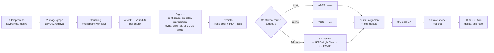

# Research proposal: rendering-aware, risk-controlled routing for hybrid SfM

**Working title:** *Which reconstructor should I trust? Rendering-aware, risk-controlled routing between feed-forward and classical SfM for Gaussian-Splatting digital twins*

**Status:** R0 (proposal), Nov 2026.

**Builds on:**
- [`HybridSfM_Pipeline.pdf`](HybridSfM_Pipeline.pdf): the 10-stage design;
- the 3DGS twin pipeline in this repo: Phases 0–3 of the [README](../../README.md).

---

## 1. Problem

Two families of methods compete for camera poses:
- **Feed-forward models** (VGGT, VGGT-Ω, MASt3R) are fast and handle low texture and wide baselines. But they fail silently: they can be confidently wrong, and their confidence is poorly calibrated.
- **Classical SfM** (COLMAP, GLOMAP) is slower and more fragile, but it can be checked geometrically. When it converges, it is precise.

A digital-twin pipeline doesn't care about pose error for its own sake. It cares whether the **3DGS model trained on those poses** renders well.

The question this project asks is:

> For each chunk of a capture, which reconstructor should be used so that the final twin is as good as possible under a compute budget, and can that choice come with a guarantee?

**Formal version:**
- A capture is split into chunks *c₁ … c_n*.
- For each chunk, choose *r(c)* from a set of reconstructors *R*, each with a GPU-time cost *k_r*:
  - VGGT;
  - VGGT + bundle adjustment;
  - VGGT-Ω;
  - classical (ALIKED + LightGlue → GLOMAP/COLMAP).
- Let *L(c, r)* be the downstream loss: the PSNR drop of a fixed 3DGS recipe trained on *r*'s poses, compared with the best reconstructor for that chunk.
- **Goal:** minimise Σ *k_r(c)* subject to *E[L] ≤ α*, using only signals available **before** any 3DGS training.

## 2. What already exists (literature check, Nov 2026)

Most of the original HybridSfM design is now covered by published or preprint work:

| PDF stage | Already done by | What it doesn't do |
|---|---|---|
| 3 + 7: chunking, Sim(3) alignment, loop closure | [VGGT-Long](https://arxiv.org/abs/2507.16443) (IRLS Sim(3), DINOv2 loop detection, pose graph), [SwiftVGGT](https://arxiv.org/abs/2511.18290) (faster SVD alignment) | Always trusts VGGT; no per-chunk choice |
| 4 → 8: VGGT, then bundle adjustment | The [VGGT repo](https://github.com/facebookresearch/vggt) (BA option), [GGPT](https://arxiv.org/abs/2603.11174) (CVPR 2026, VGGT-initialised SfM) | One fixed pipeline; no routing |
| 5: trust and failure detection | [GeoCond](https://arxiv.org/abs/2609.18465) (reliability adapter, refinement gate), [ReVar3R](https://arxiv.org/abs/2610.07883) (perturbation uncertainty), [Does VGGT know what it does not know?](https://arxiv.org/abs/2610.35806) (linear probe, AUROC 93.5 vs 79.7 for native confidence), [calibration audit](https://arxiv.org/abs/2608.29705) (confidence ranks errors but underestimates them ≥ 2.4×), [Can these views be one scene?](https://www.alphaxiv.org/abs/2605.18754) (hallucination; COLMAP-based checks) | Measured against **pose/depth error only**; no compute-aware routing; no guarantee; nothing about rendering quality |
| Backbone | [VGGT-Ω](https://arxiv.org/abs/2605.15195) (CVPR 2026 oral), [MASt3R-SfM](https://arxiv.org/abs/2409.19152), [VGGSfM](https://arxiv.org/abs/2312.04563) | — |
| Wide-baseline stress test | [When wider views fail](https://arxiv.org/abs/2609.24839) (VGGT F-score drops to 23.7% at 360° coverage) | Diagnosis only |

**The gap:** nobody yet
1. chooses between feed-forward and classical reconstruction **per chunk, under a budget**;
2. scores that choice by **downstream rendering quality** rather than pose error alone;
3. gives a **distribution-free bound** on the loss that the routing adds.

That is the contribution of this project.

⚠️ Most of these are 2026 preprints, and the area moves fast. Re-run the literature check before every milestone; §9 covers the risk of being scooped.

## 3. Contributions

- **C1: Routing formulation with downstream labels.** Per-chunk reconstructor selection under a compute budget, with labels defined by 3DGS rendering quality as well as pose error.
- **C2: Rendering-aware reliability signals and a calibrated predictor.** Cheap signals, computed before any training, that predict a chunk's downstream PSNR loss better than native confidence does.
- **C3: Conformal routing.** Thresholds chosen with conformal risk control, so the expected added loss stays ≤ α on exchangeable data. Tested for robustness when the data shifts.
- **C4: Benchmark and failure set.** Chunk-level labels (signals, pose error and 3DGS PSNR for each reconstructor), released so others can train routers without re-running 3DGS.
- **C5: Analysis.** When is feed-forward "good enough" for a Gaussian-Splatting twin, and when does pose error stop mattering for rendering?

## 4. Method

### 4.1 Pipeline (PDF stages, with the routing block replacing the pass/fail at stage 5 → 6)

### 4.2 Signals (cheap → expensive)

| Signal | What it measures | Cost |
|---|---|---|
| VGGT confidence statistics (mean, quantiles, entropy across frames) | The model's own belief (a baseline; known to be weakly calibrated) | Free |
| Epipolar residual of verified ALIKED + LightGlue matches under the predicted poses | Geometric consistency checked independently of the network | Low |
| Track reprojection error | Consistency of the predicted points with the predicted cameras | Low |
| Frame-permutation / cycle consistency (as in GeoCond) | Stability of the prediction | 2–3 extra forward passes |
| Sim(3) residual on chunk overlaps | Agreement between neighbouring chunks | Low |
| **Photometric warp consistency**: warp neighbour views with VGGT depth and poses, then compute SSIM | **Rendering-aware**: what 3DGS will actually feel | Low to medium |
| **Short 3DGS probe**: ~500 gsplat steps, then held-out PSNR | The downstream metric itself, cheaply | Medium (~1 min on a T4) |

### 4.3 Predictor and router
- **Regressor:** GBDT (LightGBM) and a small MLP, compared. They take the signals and predict, for each reconstructor, the pose error (RRA/RTA, AUC@30) and the PSNR loss.
- **Routing policy:** with a budget *B* and risk level α, use the cheapest reconstructor whose predicted loss is under a threshold λ. Choose λ by **conformal risk control** (Angelopoulos et al.) on a calibration split, so that E[L] ≤ α.
- **Oracle router:** knows the true labels. It is the upper bound.

### 4.4 Labels (reuses this repo's 3DGS pipeline)
- For each chunk and reconstructor:
  - pose error against ground truth;
  - test PSNR/SSIM/LPIPS from a **fixed short gsplat recipe**: MCMC with a 300k cap, 3k–7k steps, held-out every 8th image. This is the protocol of the README's §10.
- **Fidelity check:** on a subset, verify that short-run PSNR ranks reconstructors the same way as the full 30k recipe (Spearman ρ). The garden runs already have the 7k/30k pairs needed.
- **Engineering:** reuse notebook `02c`'s runner: one-GPU pinning (F2.2), `expandable_segments` (F2.1), per-run stats parsing, and a results table writer.

## 5. Hypotheses

- **H1:** native VGGT confidence predicts downstream PSNR loss poorly. Its AUROC for failure detection drops as coverage widens.
- **H2:** rendering-aware signals (warp-SSIM, 3DGS probe) improve AURC over geometric signals alone, and over native confidence.
- **H3:** the router reaches within ε dB of the oracle's PSNR while using a fraction of all-classical compute, and beats always-VGGT on the failure set.
- **H4:** conformal coverage holds within tolerance when calibrated on one dataset and tested on another. Where it doesn't, we report the gap.

## 6. Experiments

**Datasets** (all need ground-truth or pseudo-ground-truth poses):
- Mip-NeRF 360: garden and bicycle are already in this repo's pipeline;
- Tanks & Temples, ETH3D, CO3Dv2;
- DL3DV, after a licence check;
- **our own failure set**: phone captures with low texture, wide baselines, reflective floors (cf. the table scene) and dynamic objects. Pseudo-ground truth comes from dense COLMAP on all frames; tests run on sparse subsets.

**Baselines:**
- always-VGGT, always-VGGT+BA, always-VGGT-Ω, always-classical (COLMAP/GLOMAP);
- VGGT-Long, MASt3R-SfM;
- routing by a native-confidence threshold;
- routing by a GeoCond-style or probe score, if code is released;
- the oracle.

**Metrics:**
- risk–coverage curves and AURC;
- failure-detection AUROC;
- pose AUC@30, RRA/RTA, ATE;
- downstream PSNR/SSIM/LPIPS;
- GPU-seconds per scene;
- empirical conformal coverage.

**Ablations:**
- each signal removed in turn;
- with and without the 3DGS probe;
- chunk size and overlap;
- GBDT vs MLP;
- budget levels;
- VGGT vs VGGT-Ω backbone;
- Sim(3) vs fixed-intrinsics alignment (projective ambiguity, as raised by VGGT-SLAM).

## 7. Compute plan (free T4s)

- **VGGT-1B in fp16** on a T4 (no bf16, no FlashAttention 2), **measured in R1:**
  - 8 images: 8.2 GB peak, 5 s;
  - 32 images: 10.9 GB peak, 25 s;
  - 48 images: 13.2 GB peak, 55 s;
  - 64 images: out of memory.
  - So R2 uses chunks of about 40 images. VGGT+BA needs extra memory for track prediction (F-R1.3).
- **Label cost:** about 300 chunks × 3–4 reconstructors × about 3 min of gsplat ≈ **60 GPU-hours**.
  - Colab and Kaggle together give about 30 h a week.
  - Committed Kaggle runs keep going with the tab closed.
  - So this is about 2–3 weeks of label generation.
- The classical fallback, alignment and BA run on CPU.

## 8. Milestones

| ID | Weeks | Work | Exit criterion |
|---|---|---|---|
| R0 | 0 | This proposal, literature check | ✅ |
| R1 | 1–3 | Baselines: VGGT and VGGT+BA vs COLMAP on garden, bicycle and the table. Pose error plus 3DGS PSNR on each set of poses. Measure VGGT memory per chunk size on a T4. Notebook: [Colab](../../notebooks/04_r1_vggt_baselines_colab.ipynb) / [Kaggle](../../notebooks/04_r1_vggt_baselines.ipynb) | A table like README §10's "our COLMAP vs official poses" rows, with VGGT rows added. **First run done** (§8.1); open: bicycle VGGT+BA, the table scene |
| R2 | 4–7 | The chunk label generator: [Kaggle](../../notebooks/05_r2_labels.ipynb) / [Colab](../../notebooks/05_r2_labels_colab.ipynb). 105 chunks from 7 scenes, 3 reconstructors, tighter pose metrics, 3k-step 3DGS labels, 3k-vs-7k fidelity and an initialisation control. Chunk *merging* (Sim(3) alignment of routed chunks into one scene) moves to R4, where the router's output is assembled | Labels for ≥ 100 chunks; short-vs-long PSNR Spearman ρ reported |
| R3 | 8–12 | Signals and predictor | H1/H2 answered: AUROC/AURC vs native confidence |
| R4 | 13–16 | Conformal router and failure set | H3/H4 answered; risk–coverage plots |
| R5 | 17–20 | Full benchmark, all baselines, ablations | All tables filled |
| R6 | 21–24 | Writing, arXiv, code and label release | Submitted |

### 8.1 R1 first results (Colab T4, Nov 2026)

32 evenly spaced views per scene. Every method gets the same 3DGS recipe: MCMC 300k cap, 7k steps, every 8th view held out. Full table: README Phase 4.

| Scene | Poses | Registered | AUC@30 | Median rot. err. | PSNR (Δ vs official poses) |
|---|---|---|---|---|---|
| garden | COLMAP | 32/32 | 1.000 | 0.05° | 21.76 (−0.76) |
| garden | VGGT + BA | 32/32 | 0.999 | 0.18° | 20.62 (−1.90) |
| garden | VGGT | 32/32 | 0.995 | 0.48° | 18.32 (−4.20) |
| bicycle | COLMAP | 11/32 | 0.111 | – | not comparable (11 images) |
| bicycle | VGGT | 32/32 | 0.957 | 0.95° | 14.20 (−4.87) |
| bicycle | VGGT + BA | out of GPU memory (F-R1.3) | | | |

**What it means for the paper:**
- **H1 is supported early.** The standard pose metrics (AUC@30, RRA@5) are saturated: VGGT scores 0.995 and 1.0. Yet its twin is 4.2 dB worse than the reference. Only sub-degree error ranks the methods correctly. So routing should be trained on **downstream** labels, and the pose metrics need tighter thresholds (AUC@3/@1, focal error). These will be added in R2.
- **There is no single best reconstructor:**
  - on garden, COLMAP wins on quality, at about 10× the time;
  - on bicycle with sparse views, COLMAP loses 66% of the cameras, while VGGT registers all 32 but with a poor twin.
  
  This is the trade-off the router must learn.
- **Confound to remove in R2:** the starting point clouds differ by method (100k vs 8.9k vs 3k points). R2 trains each method once from its own points and once from the reference points moved into its frame (`r2_tools.swap_points`), on 2 chunks per scene, to isolate the pose effect.

### 8.2 R2 results (Kaggle T4, Nov 2026)

105 chunks (7 Mip-NeRF 360 scenes × 15) of 12–40 images: consecutive windows, wide-baseline strides and random sets. Loss = 3k-step 3DGS PSNR below the same chunk on official poses; 10 dB when a method gives no usable twin. Full output: [r2_summary.md](results/r2_summary.md); labels: [r2_labels.jsonl](results/r2/r2_labels.jsonl) (518 records); chunk lists: [r2_chunks.json](results/r2/r2_chunks.json).

| Policy | Mean loss | Median loss | Unusable twins | Mean pose time | Best on |
|---|---|---|---|---|---|
| always classical (ALIKED + LightGlue → COLMAP) | 3.11 dB | 1.76 dB | 19 | 34 s | 49/105 |
| always VGGT | 2.53 dB | 2.32 dB | 0 | 76 s | 21/105 |
| always VGGT + BA | 4.17 dB | 2.23 dB | 31 | 110 s | 35/105 |
| **oracle (best per chunk)** | **1.18 dB** | **1.12 dB** | 0 | 71 s | – |

| Scene | classical | VGGT | VGGT + BA | Wins (classical / VGGT / VGGT+BA) | Unusable (classical / VGGT+BA) |
|---|---|---|---|---|---|
| garden | **1.25** | 2.60 | 2.15 | 14 / 1 / 0 | 0 / 0 |
| bicycle | 3.43 | **3.05** | 3.75 | 9 / 2 / 4 | 5 / 4 |
| stump | 4.06 | **2.47** | 5.98 | 7 / 4 / 4 | 6 / 8 |
| bonsai | 3.65 | **3.23** | 4.66 | 5 / 2 / 8 | 2 / 5 |
| counter | 3.08 | **1.23** | 3.10 | 3 / 3 / 9 | 3 / 4 |
| kitchen | **2.70** | 3.76 | 4.75 | 9 / 1 / 5 | 0 / 3 |
| room | 3.60 | **1.39** | 4.84 | 2 / 8 / 5 | 3 / 7 |

**What it means for the paper:**
- **H3 has headroom:** the per-chunk oracle cuts the loss of the best fixed policy by 53% (2.53 → 1.18 dB) at similar pose time. A router that captures half of that gap is already a clear result.
- **H1 is supported at scale:** pose metrics correlate weakly with twin loss (|ρ| ≤ 0.18 for AUC@3/5/30, RRA@5, rotation error, ATE; focal error +0.26; n = 265). Caveat: pooled across chunks, so chunk difficulty is mixed in. R3 must also report within-chunk ranking accuracy.
- **Chunk type is a strong but incomplete signal:** classical wins windows (1.88 vs 3.10 dB) and fails on 19 chunks, mostly strides and random sets, where VGGT wins. Per-scene winners still differ (garden/kitchen classical, room/counter VGGT, bonsai VGGT+BA by wins), so features beyond chunk type are needed.
- **Label noise:** 3k steps ranks runs like 7k (ρ = 0.97, 51 runs), but the best method agrees on only 5/9 fidelity chunks. Near-ties are common, so R3 reports regret (dB lost vs the oracle) rather than top-1 accuracy, and the conformal step must budget for label noise.
- **Initialisation:** the reference-points control removes 0.7–1.1 dB per method but keeps the order (classical 0.45, VGGT+BA 0.64, VGGT 1.82 dB), so most of VGGT's gap is pose and intrinsics.
- **Failures are labels:** VGGT+BA fails on 31/105 chunks (19 out of memory, on 19 of the 28 40-image chunks, 12 with too few BA inliers per frame); classical leaves 19 chunks under 90% registration. One reference-points training run hit a CUDA error (room, classical); it only affects the init control.

### 8.3 R3 first results (Nov 2026)

32 features per chunk (VGGT confidence, camera layout, focal consistency, multi-view depth consistency, classical reconstruction statistics, VGGT-vs-classical agreement), none from the reference. One random forest per method predicts its loss; the router picks the lowest. Leave-one-scene-out over 105 chunks; 95% CIs by paired bootstrap. Full report: [r3_results.md](results/r3/r3_results.md); features: [features.csv](results/r3/features.csv).

| Router (fitted on 6 scenes, scored on the 7th) | Mean loss | Regret vs oracle | Within 0.5 dB of oracle | Unusable | Gap closed | vs always VGGT (95% CI) | Pose time |
|---|---|---|---|---|---|---|---|
| always VGGT (best fixed) | 2.53 | 1.35 | 31% | 0 | 0% | – | 76 s |
| kind rule (uses how the chunk was built) | 2.04 | 0.86 | 50% | 1 | 36% | −0.49 [−0.79, −0.23] | 61 s |
| one threshold: classical registered fraction | 1.68 | 0.50 | 70% | 0 | 63% | −0.86 [−1.17, −0.56] | 110 s |
| one threshold: VGGT mean confidence | 3.11 | 1.93 | 24% | 6 | −43% | +0.58 [+0.22, +1.03] | 110 s |
| learned: VGGT probe only | 2.15 | 0.97 | 55% | 0 | 28% | −0.38 [−0.57, −0.19] | 113 s |
| **learned: all features** (random forest) | **1.65** | **0.46** | **71%** | **0** | **66%** | **−0.89 [−1.16, −0.64]** | 122 s |
| learned: all features (gradient boosting) | 1.60 | 0.42 | 76% | 0 | 69% | −0.93 [−1.22, −0.64] | 133 s |
| best pose error vs ground truth (AUC@3; not deployable) | 1.60 | 0.42 | 70% | 0 | 69% | −0.94 [−1.21, −0.69] | 220 s |
| oracle | 1.18 | 0 | 100% | 0 | 100% | −1.35 | 71 s |

**What it means for the paper (honest reading):**
- **H3, partly:** routing closes 66–69% of the gap with no unusable twins, significantly better than any fixed policy. But it doesn't yet use less compute than always-VGGT: both probes are always run.
- **The strong baseline is simple.** A single threshold on the classical registered fraction gets 63%. The paper must include it, and a learned router has to beat it clearly. Today the difference (0.03 dB) is within noise.
- **H1 refined:** pose metrics fail as *absolute* predictors of twin quality across chunks (R2: |ρ| ≤ 0.18) but rank methods within a chunk 72–75% correctly. The defensible claim: pose error is neither available at test time nor sufficient. Routing on ground-truth pose error still leaves 0.37–0.43 dB regret, and the learned router without any ground truth matches it.
- **H2, not yet tested properly.** The only rendering-adjacent signal so far, multi-view depth consistency, adds little on top of classical statistics (ablation −0.02 dB), and VGGT's native confidence is worse than useless as a router. The next signals are the ones the proposal centres on: photometric warp consistency on the real images, and a short 3DGS probe (~500 steps) per candidate. They need a GPU run over the R2 chunks.
- **Small data:** 105 chunks from 7 scenes. Per-scene variance is large (the router beats both fixed policies on 4 of 7 held-out scenes; on kitchen always-classical is 0.47 dB better). More scenes (Tanks & Temples, the own failure set) are needed before the conformal step (R4) can give a meaningful guarantee.

### 8.4 R3b: short 3DGS probes (Kaggle T4, Nov 2026)

Every usable candidate on each of the 105 chunks is trained with R2's recipe for 1,000 steps ([notebook](../../notebooks/06_r3b_probes.ipynb)). Held-out PSNR at the method's own poses is recorded at 250/500/1,000 steps; no ground truth is used. Mean probe training time: 3.7 / 9.0 / 17.4 s. Full report: [r3b_results.md](results/r3b/r3b_results.md).

| Router (leave-one-scene-out, 105 chunks) | Mean loss | Within 0.5 dB of oracle | Gap closed | vs always VGGT (95% CI) | Decision time |
|---|---|---|---|---|---|
| always VGGT (best fixed) | 2.53 | 31% | 0% | – | 76 s |
| one threshold: classical registered fraction (R3) | 1.68 | 70% | 63% | −0.86 [−1.17, −0.56] | 110 s |
| learned: geometric features (R3) | 1.65 | 71% | 66% | −0.89 [−1.16, −0.64] | 122 s |
| probe@250: best probe PSNR | 1.59 | 70% | 70% | −0.94 [−1.23, −0.68] | 229 s |
| probe@500: best probe PSNR | 1.47 | 80% | 79% | −1.06 [−1.34, −0.81] | 243 s |
| **probe@1000: best probe PSNR** | **1.42** | **83%** | **83%** | **−1.12 [−1.40, −0.85]** | 264 s |
| probe@1000, classical + VGGT only (no BA run) | 1.58 | 75% | 70% | −0.95 [−1.23, −0.70] | 142 s |
| learned: geometric features + probe@1000 | 1.50 | 80% | 77% | −1.04 [−1.33, −0.74] | 264 s |
| best pose error vs ground truth (median rotation; not deployable) | 1.55 | 74% | 73% | −0.99 [−1.25, −0.74] | 220 s |
| oracle | 1.18 | 100% | 100% | −1.35 | 71 s |

**What it means for the paper:**
- **H2 supported:** a rendering-aware signal, a 1,000-step 3DGS probe, closes 83% of the oracle gap versus 63–66% for the best geometric routers. The gain is significant: −0.26 dB vs the one-threshold rule, paired-bootstrap CI [−0.44, −0.10], better on 6/7 held-out scenes.
- **H1, final form:** within a chunk, the probe ranks methods correctly 80% of the time, better than any ground-truth pose metric (69–75%). Routing on it (1.42 dB) matches or beats routing on ground-truth rotation error (1.55 dB). So for a 3DGS twin, what you can measure by rendering is a better routing signal than what you could measure with ground-truth poses.
- **The paper's real contribution becomes cost:** the probe needs every candidate reconstructed (264 s vs 76 s for always-VGGT). Probing only the cheap pair keeps 70% of the gap at 142 s. **R4:** a cost-aware cascade (geometric features decide when confident; probe otherwise) with conformal risk control on the decision, and the risk–cost curve as the main figure.
- **Learned + probe ≤ probe alone** (1.50 vs 1.42 dB): with 105 chunks, the forest doesn't add to a strong single signal. R4 should use the probe as the score and calibrate it, not learn on top of it.
- **Threat to validity:** probe and label share a measurement (held-out PSNR at the method's poses). The final benchmark (R5) must score the routed twins with an independent protocol: test cameras aligned to the reference, then rendered.

## 9. Risks and mitigations

| Risk | Mitigation |
|---|---|
| Scooped: the area is moving monthly | Post an arXiv preprint early (after R4); keep the downstream-rendering angle central, since it is the part no one covers |
| Label cost (3DGS per chunk) | Short-run proxy, validated against 30k; labels released once and reused for every ablation |
| Ground-truth poses | Datasets with ground truth plus pseudo-ground truth from dense COLMAP on all frames |
| VGGT-Ω access is by request | Apply in R1; the paper works with VGGT alone, and Ω is an ablation |
| Conformal guarantee breaks under distribution shift | Report it honestly; test weighted/adaptive conformal variants as a fix |
| Top-venue rejection | Fallback: a CVPR/ICCV workshop, then an extended journal version (RA-L, TPAMI, IJCV) |

**Venue plan:**
- main target: NeurIPS / CVPR / ICCV;
- extension: TPAMI / IJCV.
- Check deadlines at R4; none are hard-coded here.

## 10. Licences (research use)

- **VGGT original checkpoint and VGGT-Ω:** non-commercial research licences. Fine for this paper; not for a product.
- **SuperPoint weights:** non-commercial, so use **ALIKED or DISK with LightGlue** (permissive).
- **Original 3DGS code (Inria):** non-commercial. This repo uses **gsplat** (Apache-2.0).
- **Datasets:** see README §14 (WayveScenes101 stays private; DL3DV needs its licence checked).

## References

- Wang et al., *VGGT*, CVPR 2025. [arXiv 2503.11651](https://arxiv.org/abs/2503.11651)
- Wang et al., *VGGT-Ω*, CVPR 2026. [arXiv 2605.15195](https://arxiv.org/abs/2605.15195)
- Deng et al., *VGGT-Long*, 2025. [arXiv 2507.16443](https://arxiv.org/abs/2507.16443)
- *SwiftVGGT*, 2025. [arXiv 2511.18290](https://arxiv.org/abs/2511.18290)
- Chen et al., *GGPT: Geometry-Grounded Point Transformer*, CVPR 2026. [arXiv 2603.11174](https://arxiv.org/abs/2603.11174)
- *GeoCond*, 2026. [arXiv 2609.18465](https://arxiv.org/abs/2609.18465)
- *ReVar3R*, 2026. [arXiv 2610.07883](https://arxiv.org/abs/2610.07883)
- Thirumani Srinivasan, *Does VGGT Know What It Does Not Know?*, 2026. [arXiv 2610.35806](https://arxiv.org/abs/2610.35806)
- *A Calibration Audit of Confidence in Feed-Forward 3D Reconstruction Models*, 2026. [arXiv 2608.29705](https://arxiv.org/abs/2608.29705)
- *Can These Views Be One Scene?*, 2026. [alphaXiv 2605.18754](https://www.alphaxiv.org/abs/2605.18754)
- *When Wider Views Fail*, 2026. [arXiv 2609.24839](https://arxiv.org/abs/2609.24839)
- Duisterhof et al., *MASt3R-SfM*, 3DV 2025. [arXiv 2409.19152](https://arxiv.org/abs/2409.19152)
- Wang et al., *VGGSfM*, CVPR 2024. [arXiv 2312.04563](https://arxiv.org/abs/2312.04563)
- Pan et al., *GLOMAP*, ECCV 2024. [arXiv 2407.20219](https://arxiv.org/abs/2407.20219)
- Lindenberger et al., *LightGlue*, ICCV 2023. [arXiv 2306.13643](https://arxiv.org/abs/2306.13643)
- Zhao et al., *ALIKED*, 2023. [arXiv 2304.03608](https://arxiv.org/abs/2304.03608)
- Angelopoulos et al., *Conformal Risk Control*, ICLR 2024. [arXiv 2208.02814](https://arxiv.org/abs/2208.02814)
- Kheradmand et al., *3DGS as MCMC*, 2024 · Kerbl et al., *3DGS*, SIGGRAPH 2023 · *gsplat*

The 2026 entries come from a web search on 2026-11-15. Read each paper before citing it in the manuscript: author lists and venues for preprints aren't verified here.
