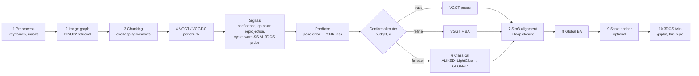

# Research proposal: rendering-aware, risk-controlled routing for hybrid SfM

**Working title:** *Which reconstructor should I trust? Rendering-aware, risk-controlled routing between feed-forward and classical SfM for Gaussian-Splatting digital twins*

**Status:** R0 (proposal), Nov 2026.

**Builds on:**
- [`HybridSfM_Pipeline.pdf`](HybridSfM_Pipeline.pdf): the 10-stage design;
- the 3DGS twin pipeline in this repo: Phases 0–3 of the [README](../../README.md).

---

## 1. Problem

Two families of methods compete for camera poses:
- **Feed-forward models** (VGGT, VGGT-Ω, MASt3R) are fast and handle low texture and wide baselines. But they fail silently: they can be confidently wrong, and their confidence is poorly calibrated.
- **Classical SfM** (COLMAP, GLOMAP) is slower and more fragile, but it can be checked geometrically. When it converges, it is precise.

A digital-twin pipeline doesn't care about pose error for its own sake. It cares whether the **3DGS model trained on those poses** renders well.

The question this project asks is:

> For each chunk of a capture, which reconstructor should be used so that the final twin is as good as possible under a compute budget, and can that choice come with a guarantee?

**Formal version:**
- A capture is split into chunks *c₁ … c_n*.
- For each chunk, choose *r(c)* from a set of reconstructors *R*, each with a GPU-time cost *k_r*:
  - VGGT;
  - VGGT + bundle adjustment;
  - VGGT-Ω;
  - classical (ALIKED + LightGlue → GLOMAP/COLMAP).
- Let *L(c, r)* be the downstream loss: the PSNR drop of a fixed 3DGS recipe trained on *r*'s poses, compared with the best reconstructor for that chunk.
- **Goal:** minimise Σ *k_r(c)* subject to *E[L] ≤ α*, using only signals available **before** any 3DGS training.

## 2. What already exists (literature check, Nov 2026)

Most of the original HybridSfM design is now covered by published or preprint work:

| PDF stage | Already done by | What it doesn't do |
|---|---|---|
| 3 + 7: chunking, Sim(3) alignment, loop closure | [VGGT-Long](https://arxiv.org/abs/2507.16443) (IRLS Sim(3), DINOv2 loop detection, pose graph), [SwiftVGGT](https://arxiv.org/abs/2511.18290) (faster SVD alignment) | Always trusts VGGT; no per-chunk choice |
| 4 → 8: VGGT, then bundle adjustment | The [VGGT repo](https://github.com/facebookresearch/vggt) (BA option), [GGPT](https://arxiv.org/abs/2603.11174) (CVPR 2026, VGGT-initialised SfM) | One fixed pipeline; no routing |
| 5: trust and failure detection | [GeoCond](https://arxiv.org/abs/2609.18465) (reliability adapter, refinement gate), [ReVar3R](https://arxiv.org/abs/2610.07883) (perturbation uncertainty), [Does VGGT know what it does not know?](https://arxiv.org/abs/2610.35806) (linear probe, AUROC 93.5 vs 79.7 for native confidence), [calibration audit](https://arxiv.org/abs/2608.29705) (confidence ranks errors but underestimates them ≥ 2.4×), [Can these views be one scene?](https://www.alphaxiv.org/abs/2605.18754) (hallucination; COLMAP-based checks) | Measured against **pose/depth error only**; no compute-aware routing; no guarantee; nothing about rendering quality |
| Backbone | [VGGT-Ω](https://arxiv.org/abs/2605.15195) (CVPR 2026 oral), [MASt3R-SfM](https://arxiv.org/abs/2409.19152), [VGGSfM](https://arxiv.org/abs/2312.04563) | — |
| Wide-baseline stress test | [When wider views fail](https://arxiv.org/abs/2609.24839) (VGGT F-score drops to 23.7% at 360° coverage) | Diagnosis only |

**The gap:** nobody yet
1. chooses between feed-forward and classical reconstruction **per chunk, under a budget**;
2. scores that choice by **downstream rendering quality** rather than pose error alone;
3. gives a **distribution-free bound** on the loss that the routing adds.

That is the contribution of this project.

⚠️ Most of these are 2026 preprints, and the area moves fast. Re-run the literature check before every milestone; §9 covers the risk of being scooped.

## 3. Contributions

- **C1: Routing formulation with downstream labels.** Per-chunk reconstructor selection under a compute budget, with labels defined by 3DGS rendering quality as well as pose error.
- **C2: Rendering-aware reliability signals and a calibrated predictor.** Cheap signals, computed before any training, that predict a chunk's downstream PSNR loss better than native confidence does.
- **C3: Conformal routing.** Thresholds chosen with conformal risk control, so the expected added loss stays ≤ α on exchangeable data. Tested for robustness when the data shifts.
- **C4: Benchmark and failure set.** Chunk-level labels (signals, pose error and 3DGS PSNR for each reconstructor), released so others can train routers without re-running 3DGS.
- **C5: Analysis.** When is feed-forward "good enough" for a Gaussian-Splatting twin, and when does pose error stop mattering for rendering?

## 4. Method

### 4.1 Pipeline (PDF stages, with the routing block replacing the pass/fail at stage 5 → 6)

### 4.2 Signals (cheap → expensive)

| Signal | What it measures | Cost |
|---|---|---|
| VGGT confidence statistics (mean, quantiles, entropy across frames) | The model's own belief (a baseline; known to be weakly calibrated) | Free |
| Epipolar residual of verified ALIKED + LightGlue matches under the predicted poses | Geometric consistency checked independently of the network | Low |
| Track reprojection error | Consistency of the predicted points with the predicted cameras | Low |
| Frame-permutation / cycle consistency (as in GeoCond) | Stability of the prediction | 2–3 extra forward passes |
| Sim(3) residual on chunk overlaps | Agreement between neighbouring chunks | Low |
| **Photometric warp consistency**: warp neighbour views with VGGT depth and poses, then compute SSIM | **Rendering-aware**: what 3DGS will actually feel | Low to medium |
| **Short 3DGS probe**: ~500 gsplat steps, then held-out PSNR | The downstream metric itself, cheaply | Medium (~1 min on a T4) |

### 4.3 Predictor and router
- **Regressor:** GBDT (LightGBM) and a small MLP, compared. They take the signals and predict, for each reconstructor, the pose error (RRA/RTA, AUC@30) and the PSNR loss.
- **Routing policy:** with a budget *B* and risk level α, use the cheapest reconstructor whose predicted loss is under a threshold λ. Choose λ by **conformal risk control** (Angelopoulos et al.) on a calibration split, so that E[L] ≤ α.
- **Oracle router:** knows the true labels. It is the upper bound.

### 4.4 Labels (reuses this repo's 3DGS pipeline)
- For each chunk and reconstructor:
  - pose error against ground truth;
  - test PSNR/SSIM/LPIPS from a **fixed short gsplat recipe**: MCMC with a 300k cap, 3k–7k steps, held-out every 8th image. This is the protocol of the README's §10.
- **Fidelity check:** on a subset, verify that short-run PSNR ranks reconstructors the same way as the full 30k recipe (Spearman ρ). The garden runs already have the 7k/30k pairs needed.
- **Engineering:** reuse notebook `02c`'s runner: one-GPU pinning (F2.2), `expandable_segments` (F2.1), per-run stats parsing, and a results table writer.

## 5. Hypotheses

- **H1:** native VGGT confidence predicts downstream PSNR loss poorly. Its AUROC for failure detection drops as coverage widens.
- **H2:** rendering-aware signals (warp-SSIM, 3DGS probe) improve AURC over geometric signals alone, and over native confidence.
- **H3:** the router reaches within ε dB of the oracle's PSNR while using a fraction of all-classical compute, and beats always-VGGT on the failure set.
- **H4:** conformal coverage holds within tolerance when calibrated on one dataset and tested on another. Where it doesn't, we report the gap.

## 6. Experiments

**Datasets** (all need ground-truth or pseudo-ground-truth poses):
- Mip-NeRF 360: garden and bicycle are already in this repo's pipeline;
- Tanks & Temples, ETH3D, CO3Dv2;
- DL3DV, after a licence check;
- **our own failure set**: phone captures with low texture, wide baselines, reflective floors (cf. the table scene) and dynamic objects. Pseudo-ground truth comes from dense COLMAP on all frames; tests run on sparse subsets.

**Baselines:**
- always-VGGT, always-VGGT+BA, always-VGGT-Ω, always-classical (COLMAP/GLOMAP);
- VGGT-Long, MASt3R-SfM;
- routing by a native-confidence threshold;
- routing by a GeoCond-style or probe score, if code is released;
- the oracle.

**Metrics:**
- risk–coverage curves and AURC;
- failure-detection AUROC;
- pose AUC@30, RRA/RTA, ATE;
- downstream PSNR/SSIM/LPIPS;
- GPU-seconds per scene;
- empirical conformal coverage.

**Ablations:**
- each signal removed in turn;
- with and without the 3DGS probe;
- chunk size and overlap;
- GBDT vs MLP;
- budget levels;
- VGGT vs VGGT-Ω backbone;
- Sim(3) vs fixed-intrinsics alignment (projective ambiguity, as raised by VGGT-SLAM).

## 7. Compute plan (free T4s)

- **VGGT-1B in fp16** on a T4 (no bf16, no FlashAttention 2): about 30–50 images per chunk is expected. **Measure this first in R1.**
- **Label cost:** about 300 chunks × 3–4 reconstructors × about 3 min of gsplat ≈ **60 GPU-hours**.
  - Colab and Kaggle together give about 30 h a week.
  - Committed Kaggle runs keep going with the tab closed.
  - So this is about 2–3 weeks of label generation.
- The classical fallback, alignment and BA run on CPU.

## 8. Milestones

| ID | Weeks | Work | Exit criterion |
|---|---|---|---|
| R0 | 0 | This proposal, literature check | ✅ |
| R1 | 1–3 | Baselines: VGGT and VGGT+BA vs COLMAP on garden, bicycle and the table. Pose error plus 3DGS PSNR on each set of poses. Measure VGGT memory per chunk size on a T4. Notebook: [`04_r1_vggt_baselines.ipynb`](../../notebooks/04_r1_vggt_baselines.ipynb) | A table like README §10's "our COLMAP vs official poses" rows, with VGGT rows added |
| R2 | 4–7 | Chunking, Sim(3) alignment, the label generator (Kaggle) | Labels for ≥ 100 chunks; short-vs-30k PSNR Spearman ρ reported |
| R3 | 8–12 | Signals and predictor | H1/H2 answered: AUROC/AURC vs native confidence |
| R4 | 13–16 | Conformal router and failure set | H3/H4 answered; risk–coverage plots |
| R5 | 17–20 | Full benchmark, all baselines, ablations | All tables filled |
| R6 | 21–24 | Writing, arXiv, code and label release | Submitted |

## 9. Risks and mitigations

| Risk | Mitigation |
|---|---|
| Scooped: the area is moving monthly | Post an arXiv preprint early (after R4); keep the downstream-rendering angle central, since it is the part no one covers |
| Label cost (3DGS per chunk) | Short-run proxy, validated against 30k; labels released once and reused for every ablation |
| Ground-truth poses | Datasets with ground truth plus pseudo-ground truth from dense COLMAP on all frames |
| VGGT-Ω access is by request | Apply in R1; the paper works with VGGT alone, and Ω is an ablation |
| Conformal guarantee breaks under distribution shift | Report it honestly; test weighted/adaptive conformal variants as a fix |
| Top-venue rejection | Fallback: a CVPR/ICCV workshop, then an extended journal version (RA-L, TPAMI, IJCV) |

**Venue plan:**
- main target: NeurIPS / CVPR / ICCV;
- extension: TPAMI / IJCV.
- Check deadlines at R4; none are hard-coded here.

## 10. Licences (research use)

- **VGGT original checkpoint and VGGT-Ω:** non-commercial research licences. Fine for this paper; not for a product.
- **SuperPoint weights:** non-commercial, so use **ALIKED or DISK with LightGlue** (permissive).
- **Original 3DGS code (Inria):** non-commercial. This repo uses **gsplat** (Apache-2.0).
- **Datasets:** see README §14 (WayveScenes101 stays private; DL3DV needs its licence checked).

## References

- Wang et al., *VGGT*, CVPR 2025. [arXiv 2503.11651](https://arxiv.org/abs/2503.11651)
- Wang et al., *VGGT-Ω*, CVPR 2026. [arXiv 2605.15195](https://arxiv.org/abs/2605.15195)
- Deng et al., *VGGT-Long*, 2025. [arXiv 2507.16443](https://arxiv.org/abs/2507.16443)
- *SwiftVGGT*, 2025. [arXiv 2511.18290](https://arxiv.org/abs/2511.18290)
- Chen et al., *GGPT: Geometry-Grounded Point Transformer*, CVPR 2026. [arXiv 2603.11174](https://arxiv.org/abs/2603.11174)
- *GeoCond*, 2026. [arXiv 2609.18465](https://arxiv.org/abs/2609.18465)
- *ReVar3R*, 2026. [arXiv 2610.07883](https://arxiv.org/abs/2610.07883)
- Thirumani Srinivasan, *Does VGGT Know What It Does Not Know?*, 2026. [arXiv 2610.35806](https://arxiv.org/abs/2610.35806)
- *A Calibration Audit of Confidence in Feed-Forward 3D Reconstruction Models*, 2026. [arXiv 2608.29705](https://arxiv.org/abs/2608.29705)
- *Can These Views Be One Scene?*, 2026. [alphaXiv 2605.18754](https://www.alphaxiv.org/abs/2605.18754)
- *When Wider Views Fail*, 2026. [arXiv 2609.24839](https://arxiv.org/abs/2609.24839)
- Duisterhof et al., *MASt3R-SfM*, 3DV 2025. [arXiv 2409.19152](https://arxiv.org/abs/2409.19152)
- Wang et al., *VGGSfM*, CVPR 2024. [arXiv 2312.04563](https://arxiv.org/abs/2312.04563)
- Pan et al., *GLOMAP*, ECCV 2024. [arXiv 2407.20219](https://arxiv.org/abs/2407.20219)
- Lindenberger et al., *LightGlue*, ICCV 2023. [arXiv 2306.13643](https://arxiv.org/abs/2306.13643)
- Zhao et al., *ALIKED*, 2023. [arXiv 2304.03608](https://arxiv.org/abs/2304.03608)
- Angelopoulos et al., *Conformal Risk Control*, ICLR 2024. [arXiv 2208.02814](https://arxiv.org/abs/2208.02814)
- Kheradmand et al., *3DGS as MCMC*, 2024 · Kerbl et al., *3DGS*, SIGGRAPH 2023 · *gsplat*

The 2026 entries come from a web search on 2026-11-15. Read each paper before citing it in the manuscript: author lists and venues for preprints aren't verified here.
