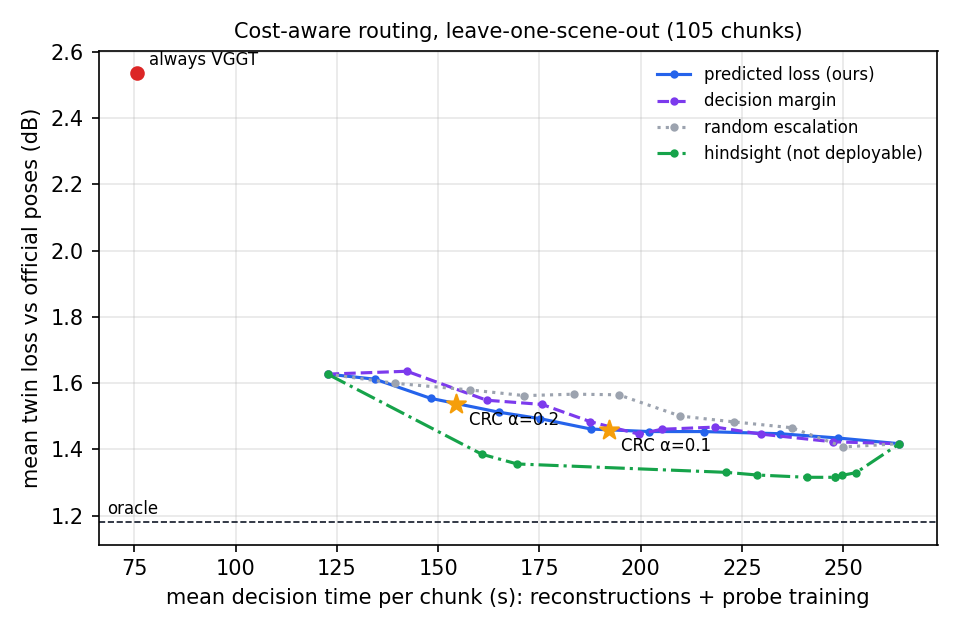

# R4: cost-aware cascade with conformal risk control

**105 chunks, 7 scenes, leave-one-scene-out.** Stage 1 always runs classical + VGGT and the R3 geometric router picks a method. Escalation adds VGGT+BA and a 1000-step 3DGS probe of every usable candidate (R3b), and the best probe wins. Loss = dB below the official poses (3k-step 3DGS). Time = reconstructions + probe training, mean per chunk.

| Reference policy | Mean loss | Mean time |
|---|---|---|
| always VGGT | 2.53 | 76 s |
| stage 1 only (never escalate) | 1.63 | 123 s |
| always escalate (probe everything) | 1.42 | 264 s |
| oracle | 1.18 | – |

Stage 1's choice is more than 0.5 dB worse than the best method on 28% of chunks. Escalating changes the outcome for the better on 29 chunks and for the worse on 16.

**Cost–quality curve** (escalate a target share of chunks; the threshold is that quantile of the calibration scores from the other 6 scenes):

| Escalated (target) | pred_loss: loss / time | margin: loss / time | random: loss / time | hindsight: loss / time |
|---|---|---|---|---|
| 0% | 1.63 dB / 123 s | 1.63 dB / 123 s | 1.63 dB / 123 s | 1.63 dB / 123 s |
| 10% | 1.61 dB / 134 s | 1.64 dB / 142 s | 1.60 dB / 139 s | 1.39 dB / 161 s |
| 20% | 1.55 dB / 148 s | 1.55 dB / 162 s | 1.58 dB / 158 s | 1.36 dB / 169 s |
| 30% | 1.51 dB / 165 s | 1.54 dB / 176 s | 1.56 dB / 171 s | 1.33 dB / 221 s |
| 40% | 1.49 dB / 175 s | 1.48 dB / 188 s | 1.57 dB / 184 s | 1.32 dB / 229 s |
| 50% | 1.46 dB / 188 s | 1.45 dB / 200 s | 1.56 dB / 195 s | 1.32 dB / 241 s |
| 60% | 1.45 dB / 202 s | 1.46 dB / 205 s | 1.50 dB / 210 s | 1.32 dB / 248 s |
| 70% | 1.45 dB / 216 s | 1.47 dB / 218 s | 1.48 dB / 223 s | 1.32 dB / 248 s |
| 80% | 1.45 dB / 234 s | 1.45 dB / 230 s | 1.47 dB / 237 s | 1.32 dB / 250 s |
| 90% | 1.43 dB / 249 s | 1.42 dB / 247 s | 1.41 dB / 250 s | 1.33 dB / 253 s |
| 100% | 1.42 dB / 264 s | 1.42 dB / 264 s | 1.42 dB / 264 s | 1.42 dB / 264 s |

**Conformal risk control** (risk = share of chunks where the probe was skipped although stage 1's choice was > 0.5 dB worse than the best method). λ calibrated on the other 6 scenes, tested on the held-out scene; the guarantee assumes exchangeable chunks, which scene shift violates, so this is the hard test:

| Score | α | Realized risk | Scenes over α | Escalated | Mean loss | Mean time |
|---|---|---|---|---|---|---|
| pred_loss | 0.05 | 0.048 | 4/7 | 75% | 1.45 | 226 s |
| pred_loss | 0.1 | 0.095 | 3/7 | 51% | 1.46 | 192 s |
| pred_loss | 0.2 | 0.190 | 2/7 | 26% | 1.54 | 154 s |
| pred_loss | 0.3 | 0.267 | 3/7 | 4% | 1.62 | 128 s |
| margin | 0.05 | 0.057 | 3/7 | 75% | 1.45 | 231 s |
| margin | 0.1 | 0.076 | 3/7 | 56% | 1.45 | 201 s |
| margin | 0.2 | 0.190 | 2/7 | 29% | 1.56 | 159 s |
| margin | 0.3 | 0.248 | 2/7 | 8% | 1.62 | 133 s |
| random | 0.05 | 0.029 | 3/7 | 80% | 1.46 | 234 s |
| random | 0.1 | 0.067 | 1/7 | 68% | 1.49 | 219 s |
| random | 0.2 | 0.152 | 1/7 | 45% | 1.59 | 185 s |
| random | 0.3 | 0.248 | 2/7 | 10% | 1.62 | 136 s |

**Exchangeable check** (predicted-loss score; 1,000 random 50/50 splits of the 105 chunks; scores are out-of-scene; calibrate on one half, test on the other):

| α | Mean realized risk | Splits over α | Escalated |
|---|---|---|---|
| 0.05 | 0.037 | 30% | 88% |
| 0.1 | 0.090 | 33% | 54% |
| 0.2 | 0.186 | 40% | 28% |
| 0.3 | 0.264 | 36% | 6% |
