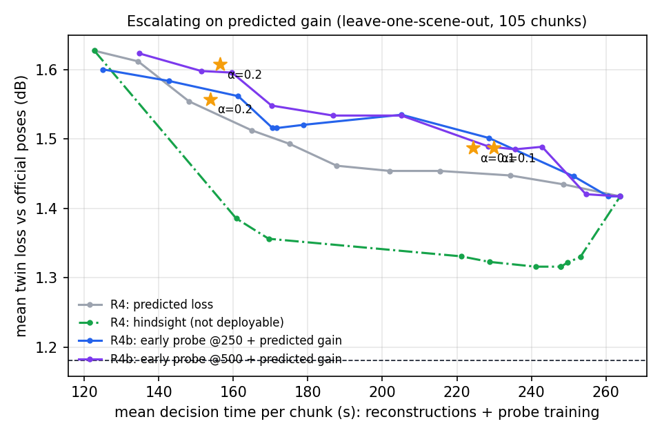

# R4b: escalation on predicted gain, after a cheap early probe

Stage 1.5 adds an early 3DGS probe of classical and VGGT to the geometric router; the escalation score predicts the gain from escalating (which can be negative). Same leave-one-scene-out protocol, risk and conformal calibration as R4 ([r4_results.md](r4_results.md)); all scores nested and out-of-scene.

| Policy | Escalated | Mean loss | Mean time | Realized risk | Scenes over α |
|---|---|---|---|---|---|
| R4 stage 1 only (geometric router) | 0% | 1.63 | 123 s | 0.28 | – |
| R4 cascade, α = 0.1 (predicted loss) | 51% | 1.46 | 192 s | 0.095 | 3/7 |
| R4 cascade, α = 0.2 (predicted loss) | 26% | 1.54 | 154 s | 0.190 | 2/7 |
| **R4b stage 1.5 only (early probe @250)** | 0% | 1.60 | 125 s | 0.25 | – |
| R4b @250, α = 0.05 (predicted gain) | 95% | 1.44 | 256 s | 0.019 | 1/7 |
| R4b @250, α = 0.1 (predicted gain) | 72% | 1.49 | 224 s | 0.095 | 3/7 |
| R4b @250, α = 0.2 (predicted gain) | 21% | 1.56 | 154 s | 0.171 | 2/7 |
| R4b @250, α = 0.3 (predicted gain) | 0% | 1.60 | 125 s | 0.248 | 2/7 |
| **R4b stage 1.5 only (early probe @500)** | 0% | 1.62 | 135 s | 0.25 | – |
| R4b @500, α = 0.05 (predicted gain) | 95% | 1.42 | 258 s | 0.000 | 0/7 |
| R4b @500, α = 0.1 (predicted gain) | 74% | 1.49 | 230 s | 0.057 | 2/7 |
| R4b @500, α = 0.2 (predicted gain) | 19% | 1.61 | 156 s | 0.190 | 3/7 |
| R4b @500, α = 0.3 (predicted gain) | 1% | 1.62 | 135 s | 0.248 | 2/7 |
| always escalate | 100% | 1.42 | 264 s | 0 | – |
| oracle | – | 1.18 | – | – | – |

**Early probe @250:** escalation helps on 27 chunks and hurts on 14; predicted vs true gain Spearman ρ = 0.02.

| Escalated (target) | Mean loss | Mean time | Risk |
|---|---|---|---|
| 0% | 1.60 dB | 125 s | 0.248 |
| 10% | 1.58 dB | 143 s | 0.190 |
| 20% | 1.56 dB | 161 s | 0.162 |
| 30% | 1.52 dB | 171 s | 0.143 |
| 40% | 1.52 dB | 172 s | 0.133 |
| 50% | 1.52 dB | 179 s | 0.124 |
| 60% | 1.53 dB | 205 s | 0.124 |
| 70% | 1.50 dB | 229 s | 0.095 |
| 80% | 1.45 dB | 251 s | 0.029 |
| 90% | 1.42 dB | 261 s | 0.000 |
| 100% | 1.42 dB | 264 s | 0.000 |

Exchangeable check (1,000 random 50/50 splits): α = 0.05: mean risk 0.034, 29% of splits over; α = 0.1: mean risk 0.090, 35% of splits over; α = 0.2: mean risk 0.189, 43% of splits over; α = 0.3: mean risk 0.245, 15% of splits over.

**Early probe @500:** escalation helps on 24 chunks and hurts on 14; predicted vs true gain Spearman ρ = -0.05.

| Escalated (target) | Mean loss | Mean time | Risk |
|---|---|---|---|
| 0% | 1.62 dB | 135 s | 0.248 |
| 10% | 1.60 dB | 151 s | 0.200 |
| 20% | 1.60 dB | 160 s | 0.181 |
| 30% | 1.55 dB | 170 s | 0.133 |
| 40% | 1.53 dB | 187 s | 0.105 |
| 50% | 1.53 dB | 205 s | 0.105 |
| 60% | 1.49 dB | 228 s | 0.057 |
| 70% | 1.49 dB | 236 s | 0.038 |
| 80% | 1.49 dB | 243 s | 0.029 |
| 90% | 1.42 dB | 255 s | 0.000 |
| 100% | 1.42 dB | 264 s | 0.000 |

Exchangeable check (1,000 random 50/50 splits): α = 0.05: mean risk 0.038, 32% of splits over; α = 0.1: mean risk 0.091, 36% of splits over; α = 0.2: mean risk 0.190, 44% of splits over; α = 0.3: mean risk 0.247, 16% of splits over.

