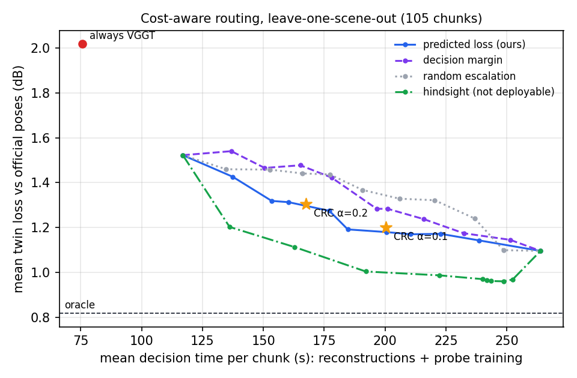

# R4: cost-aware cascade with conformal risk control

**105 chunks, 7 scenes, leave-one-scene-out.** Stage 1 always runs classical + VGGT and the R3 geometric router picks a method. Escalation adds VGGT+BA and a 1000-step 3DGS probe of every usable candidate (R3b), and the best probe wins. Loss = dB below the official poses (3k-step 3DGS). Time = reconstructions + probe training, mean per chunk.

| Reference policy | Mean loss | Mean time |
|---|---|---|
| always VGGT | 2.02 | 76 s |
| stage 1 only (never escalate) | 1.52 | 117 s |
| always escalate (probe everything) | 1.10 | 264 s |
| oracle | 0.82 | – |

Stage 1's choice is more than 0.5 dB worse than the best method on 35% of chunks. Escalating changes the outcome for the better on 40 chunks and for the worse on 13.

**Cost–quality curve** (escalate a target share of chunks; the threshold is that quantile of the calibration scores from the other 6 scenes):

| Escalated (target) | pred_loss: loss / time | margin: loss / time | random: loss / time | hindsight: loss / time |
|---|---|---|---|---|
| 0% | 1.52 dB / 117 s | 1.52 dB / 117 s | 1.52 dB / 117 s | 1.52 dB / 117 s |
| 10% | 1.43 dB / 137 s | 1.54 dB / 137 s | 1.46 dB / 135 s | 1.20 dB / 136 s |
| 20% | 1.32 dB / 153 s | 1.47 dB / 151 s | 1.46 dB / 153 s | 1.11 dB / 163 s |
| 30% | 1.31 dB / 160 s | 1.48 dB / 165 s | 1.44 dB / 166 s | 1.00 dB / 192 s |
| 40% | 1.27 dB / 177 s | 1.42 dB / 178 s | 1.44 dB / 177 s | 0.99 dB / 222 s |
| 50% | 1.19 dB / 185 s | 1.28 dB / 197 s | 1.37 dB / 191 s | 0.97 dB / 240 s |
| 60% | 1.18 dB / 200 s | 1.28 dB / 201 s | 1.33 dB / 206 s | 0.96 dB / 242 s |
| 70% | 1.17 dB / 210 s | 1.24 dB / 216 s | 1.32 dB / 220 s | 0.96 dB / 243 s |
| 80% | 1.17 dB / 223 s | 1.17 dB / 232 s | 1.24 dB / 237 s | 0.96 dB / 249 s |
| 90% | 1.14 dB / 238 s | 1.14 dB / 251 s | 1.10 dB / 249 s | 0.97 dB / 252 s |
| 100% | 1.10 dB / 264 s | 1.10 dB / 264 s | 1.10 dB / 264 s | 1.10 dB / 264 s |

**Conformal risk control** (risk = share of chunks where the probe was skipped although stage 1's choice was > 0.5 dB worse than the best method). λ calibrated on the other 6 scenes, tested on the held-out scene; the guarantee assumes exchangeable chunks, which scene shift violates, so this is the hard test:

| Score | α | Realized risk | Scenes over α | Escalated | Mean loss | Mean time |
|---|---|---|---|---|---|---|
| pred_loss | 0.05 | 0.057 | 3/7 | 77% | 1.15 | 228 s |
| pred_loss | 0.1 | 0.114 | 2/7 | 59% | 1.20 | 200 s |
| pred_loss | 0.2 | 0.190 | 2/7 | 37% | 1.30 | 167 s |
| pred_loss | 0.3 | 0.267 | 3/7 | 23% | 1.37 | 146 s |
| margin | 0.05 | 0.038 | 2/7 | 89% | 1.17 | 247 s |
| margin | 0.1 | 0.095 | 4/7 | 63% | 1.27 | 210 s |
| margin | 0.2 | 0.200 | 3/7 | 34% | 1.48 | 168 s |
| margin | 0.3 | 0.286 | 3/7 | 15% | 1.49 | 138 s |
| random | 0.05 | 0.029 | 2/7 | 88% | 1.14 | 245 s |
| random | 0.1 | 0.095 | 3/7 | 74% | 1.30 | 226 s |
| random | 0.2 | 0.200 | 2/7 | 51% | 1.38 | 189 s |
| random | 0.3 | 0.295 | 4/7 | 28% | 1.44 | 155 s |

**Exchangeable check** (predicted-loss score; 1,000 random 50/50 splits of the 105 chunks; scores are out-of-scene; calibrate on one half, test on the other):

| α | Mean realized risk | Splits over α | Escalated |
|---|---|---|---|
| 0.05 | 0.038 | 32% | 85% |
| 0.1 | 0.091 | 34% | 63% |
| 0.2 | 0.195 | 45% | 37% |
| 0.3 | 0.284 | 45% | 17% |
